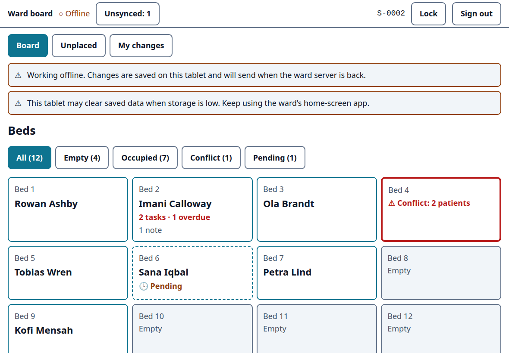
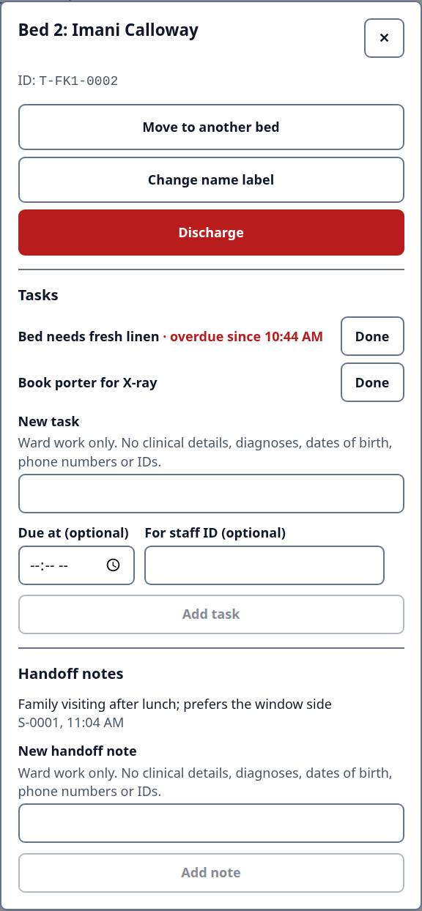
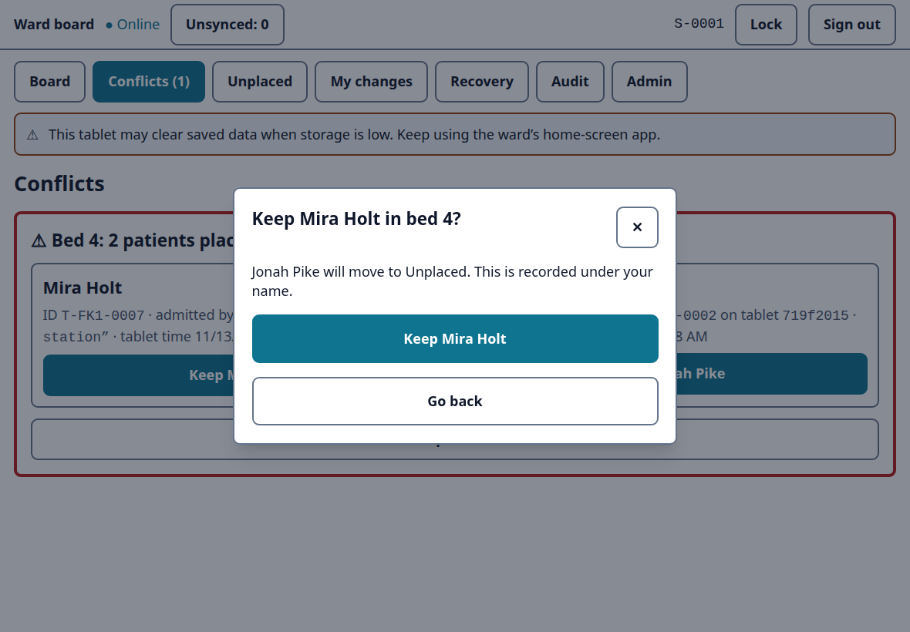
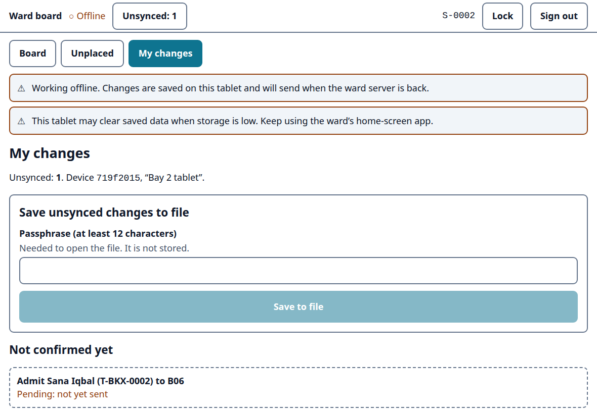

# Ward Downtime Board

An offline-first bed board for hospital wards. When the EHR or network goes down, tablets keep working, record changes independently, and merge safely afterward. Conflicts (two patients in one bed) are never silently overwritten; a charge nurse resolves them.

> **Synthetic data only.** This is a portfolio project. It handles no real patient information and makes no HIPAA or medical-device compliance claim.

## Screenshots

A tablet that has lost the network keeps working. The admit to bed 6 is saved on the tablet and marked Pending until the ward server confirms it. Bed 4 was admitted twice on two offline tablets, so it waits for the charge nurse.



| Bed sheet: tasks and handoff notes | Charge nurse keeps one patient | Changes not yet confirmed |
|---|---|---|
|  |  |  |

All names are made up (see [DATA_POLICY.md](DATA_POLICY.md)). Captured with Playwright from the real app at iPad landscape size; regenerate with `WDB_SCREENSHOTS=1 pnpm e2e --project=chromium e2e/screenshots.spec.ts`.

## The problem
When the EHR or the network is down, a ward still admits, moves and discharges patients. This project explores how tablets on the ward can keep a shared, trustworthy bed board through that outage, and hand clean, back-dated changes to the EHR team afterward. (How long reconciliation takes in real hospitals is NOT VERIFIED here.)

## How it works
- Every change is an immutable event with a unique ID, queued locally if offline.
- The ward server assigns a global order; every device replays the same log to the same board.
- Retries are safe (idempotent). Pending changes are visibly marked until confirmed.
- One patient per bed: a clash opens a conflict, both admits are held, a charge nurse picks one.
- A recovery export gives back-dated events with temporary IDs for later EHR reconciliation.
- Events are signed by each tablet's own key and hash-chained on the server; tampering is detected on the server and on every tablet.
- v2 adds tasks and shift handoff notes per bed, with short free text that refuses anything shaped like an identifier.

## Stack
TypeScript, React 19 PWA (IndexedDB), Fastify, PostgreSQL, Caddy with a local CA, Docker Compose. Tests: Vitest, fast-check, Playwright, Toxiproxy.

## Docs
- [prd.md](prd.md): what and why
- [security.md](security.md): threat model and controls
- [design.md](design.md): architecture and build plan
- [TESTING.md](TESTING.md), [DATA_POLICY.md](DATA_POLICY.md), [GLOSSARY.md](GLOSSARY.md)
- Runbooks: [TLS and first setup](docs/runbooks/RB-TLS.md), [backup and restore](docs/runbooks/RB-BACKUP.md), [alerts](docs/runbooks/alerts.md)
- [docs/security/asvs-l2.md](docs/security/asvs-l2.md): OWASP ASVS 5.0.0 L2 and Top 10:2025 self-review
- [CONTRIBUTING.md](CONTRIBUTING.md), [SECURITY.md](SECURITY.md), [CLAUDE.md](CLAUDE.md) (rules for AI agents)

## Run it
The whole ward stack (Caddy with TLS 1.3, the ward server, Postgres, a demo step-ca, encrypted backups):

```bash
./deploy/init-secrets.sh
docker compose up -d --build
```

Then follow [RB-TLS](docs/runbooks/RB-TLS.md) to trust the demo root, add the first admin and approve the first tablet. The app is at `https://wdb.localhost`.

Tests (Node from `.nvmrc`, pnpm, Docker):

```bash
pnpm install
docker compose up -d db-test
pnpm test
pnpm e2e
```

## Status
v1 (milestones M1 to M5) and v2 (M6: tasks and handoff notes) are built and tested in CI: unit, property, integration, E2E on Chromium, Firefox and WebKit, network faults, and security checks. Not done: tests on a real iPad, a manual screen-reader pass, and any use with real patients (it is not meant for that). Details in [TASKS.md](TASKS.md) and design.md §14.

## License
[MIT](LICENSE)
