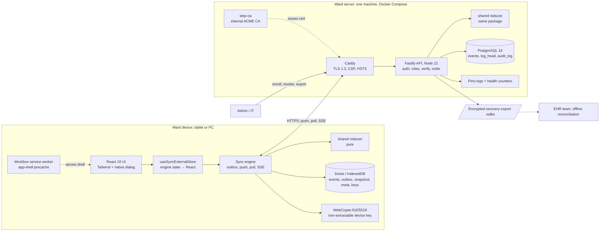
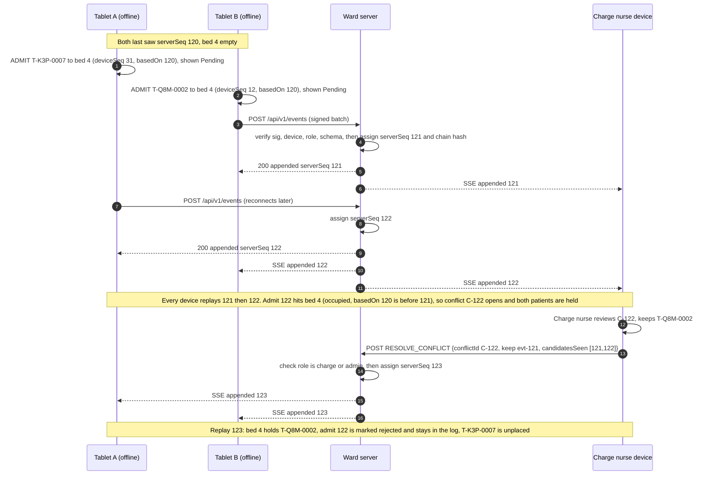
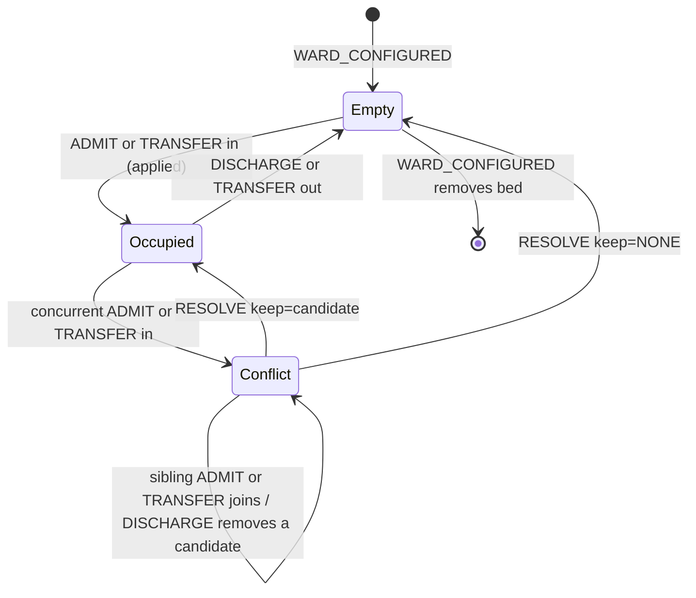
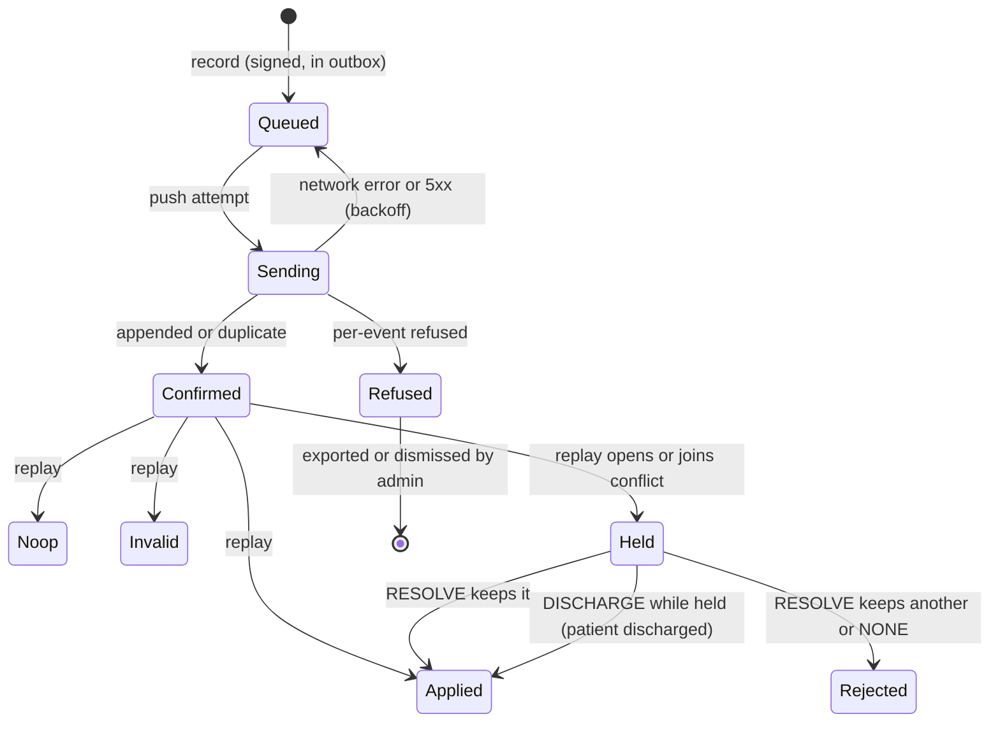
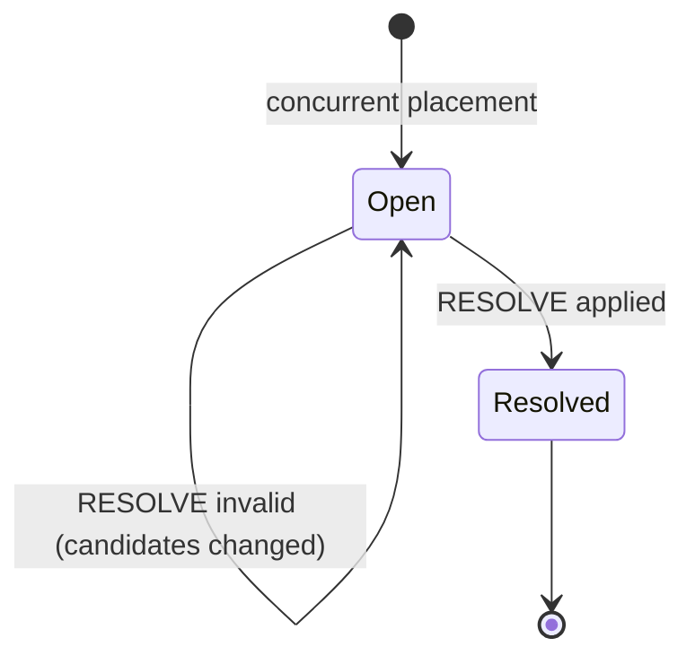

# design.md: Ward Downtime Board

Status: Draft v1 · Date: 2026-11-11 · Sources of requirements: [prd.md](prd.md), [security.md](security.md)

> **Synthetic data only.** Every name, ID and record in this design, its examples and its tests is made up (Synthea / @faker-js/faker / hand-written). This project makes **no** HIPAA-compliance, FDA, medical-device or certification claim. It is *designed toward* HIPAA Security Rule safeguards.

## Conflicts found

**None between prd.md and security.md.** I checked every FR against every SEC item. Three minor tensions are resolved here without changing either file:

| # | Tension | Resolution in this design |
|---|---|---|
| T1 | FR-11 requires a JSON + CSV export, and SEC-15 requires exports encrypted by default. Plain CSV cannot be encrypted. | Both files go inside one encrypted envelope (`.wdbx`, §7.3). A plaintext export needs an explicit admin opt-out and is audited. |
| T2 | NFR "Offline: FR-1 to FR-12 work with zero connectivity" includes FR-7 (resolve), but conflicts are only *detected* after server ordering. | A resolution can be *recorded* offline (it is an event). It takes effect once ordered. Conflicts can only be seen on devices that have pulled the conflicting events (§6.6). |
| T3 | README links `docs/design.md`, but this task places design.md at the repo root. | design.md lives at the root; the README link now points there (OQ-1). |

---

## 1. Summary and scope

The Ward Downtime Board is an offline-first bed board for one hospital ward. Every change is an immutable, signed **event**. Devices (tablets/PCs running a PWA) queue events locally and push them to a **ward server**. The server assigns a global order (`serverSeq`) and appends to a hash-chained log. Every device replays the same log through the same pure reducer (`packages/shared`) and gets the same board. The invariant is one patient per bed. Two placements into one bed open a **conflict**: both patients are held unplaced until a charge nurse resolves it with a `RESOLVE_CONFLICT` event. Losing events stay in the log, marked `rejected`. When downtime ends, an encrypted **recovery export** of applied events, with original device times and temporary patient IDs, supports back-dated entry into the EHR.

| | v1 (build first) | v2 (later) |
|---|---|---|
| Board | One ward, configurable beds; admit, discharge, transfer, rename | Unchanged |
| Sync | Offline queue, push/pull, SSE, pending/confirmed/conflict | Unchanged |
| Conflicts | One patient per bed; charge-nurse resolution | Same rules extended to task assignment |
| Identity | Temporary IDs `T-<prefix>-<n>`, recovery export | Unchanged |
| Security | Device keys, staff PIN, roles, hash chain, audit | Passkeys (OQ-4) |
| Tasks / handoff | Not built | FR-15: tasks per bed (`TASK_CREATED`, `TASK_COMPLETED`, built in M6a); handoff notes per bed (`HANDOFF_NOTE_ADDED`, M6b), under the OQ-8 free-text policy (SEC-16) |

**Non-goals** (from prd.md §4): not an EHR, no orders/meds/results, no EHR write-back in v1, no real data, no multi-hospital/cloud mode.

**Six known gaps and where they close:**

| Gap | Closed in |
|---|---|
| 1. HTTPS / secure context on a ward LAN | §9.3, §11.2 |
| 2. Storage eviction and iOS limits | §8 |
| 3. Ordering, idempotent replay, pending state, sibling conflicts | §5, §6 |
| 4. Why CRDTs cannot enforce uniqueness | §6.1, ADR-004 |
| 5. Patient identity and reconciliation | §7 |
| 6. Security and HIPAA-aligned design without a claim | §9 |

---

## 2. Requirements traceability

prd.md defines FR-1 to FR-15. security.md defines SEC-1 to SEC-31. prd.md §6 NFRs have no IDs, so they are labelled `NFR-<name>` here.

### 2.1 Functional requirements

| ID | Requirement (short) | Satisfied in | Verified by (§12) |
|---|---|---|---|
| FR-1 | Every bed shows occupant, status, sync state | §4.1, §10.2, §10.4 | E2E-01, UNIT-BED |
| FR-2 | Admit/discharge/transfer/rename with no network | §5.1, §8, §10.3 | E2E-02, PB-01 |
| FR-3 | Immutable event, device-generated unique ID | §4.1, §4.3 | UNIT-SCHEMA |
| FR-4 | Retried pushes never duplicate | §5.3 | INT-IDEM, E2E-03, PB-02 |
| FR-5 | Server global order; all replay to same board | §5.4, §6.2 | PB-01, SIM-01 |
| FR-6 | Two admits to one bed open a conflict, neither overwritten | §6.3, §6.5 | UNIT-CONFLICT, E2E-01 |
| FR-7 | Charge nurse resolves; resolution is an event | §4.2 `RESOLVE_CONFLICT`, §6.3, §10.2 | E2E-01, SEC-T-ROLE |
| FR-8 | Rejected events stay in the log, marked rejected | §4.4 (append-only), §6.2 outcomes | UNIT-CONFLICT, INT-APPEND |
| FR-9 | Rename = later-in-server-order wins | §6.3 RENAME, ADR-005 | PB-04 |
| FR-10 | Pending visibly differs from confirmed | §5.5, §10.4, §10.6 | E2E-02, A11Y-02 |
| FR-11 | Recovery export JSON + CSV, applied only, original times, temp IDs | §7.2, §7.3 | E2E-06, UNIT-EXPORT |
| FR-12 | Export unsynced queue to file | §8.4 | E2E-07 |
| FR-13 | Staff and device sign-in; roles | §9.4, §9.5 | SEC-T-AUTH |
| FR-14 | Audit log view and export | §9.7, §10.2 `AuditView` | INT-AUDIT |
| FR-15 | Tasks and handoff notes (v2) | §1 (v2 scope), §4.2 (reserved types), §14 M6 | M6 exit criteria |

### 2.2 Security requirements

| ID | Requirement (short) | Satisfied in | Verified by |
|---|---|---|---|
| SEC-1 | TLS 1.3 only | §9.3, §11.2 | SEC-T-TLS |
| SEC-2 | Local CA, one permanent hostname, pre-installed | §9.3, §11.2 | Runbook RB-TLS drill |
| SEC-3 | HSTS, no mixed content, strict CSP, no 3rd-party runtime scripts | §9.3 | SEC-T-HDR |
| SEC-4 | Device keypair (WebCrypto, non-extractable), admin approval | §9.2 | SEC-T-ENROLL |
| SEC-5 | Short-lived staff session, PIN/passkey, no shared logins, lockout, rate limit | §9.4 | SEC-T-AUTH |
| SEC-6 | Roles enforced server-side; only charge/admin resolve | §9.5 | SEC-T-ROLE |
| SEC-7 | Offline cached expiring credential; idle lock (5 min default) | §9.4.3 | E2E-08 |
| SEC-8 | Revocation effective at next sync, blocks pushes | §9.2.3 | SEC-T-REVOKE |
| SEC-9 | Events signed; server verifies sig, device status, role | §5.3, §9.6 | SEC-T-SIG |
| SEC-10 | Append-only, hash-chained log | §4.4, §9.6 | INT-CHAIN, SEC-T-TAMPER |
| SEC-11 | Strict schema, unknown fields rejected, size limits, idempotency | §4.3, §5.3 | UNIT-SCHEMA, SEC-T-SIZE |
| SEC-12 | No client timestamps for ordering | §5.4, ADR-002 | PB-05 |
| SEC-13 | Encrypted DB volume and backups | §11.1, §11.3 | Backup drill |
| SEC-14 | Minimum client fields; device lock/MDM/idle/remote wipe; optional PIN-derived DB key | §4.5, §9.2.3, §9.9 | SEC-T-WIPE |
| SEC-15 | Exports encrypted by default, classification banner | §7.3 | UNIT-EXPORT |
| SEC-16 | Name label + temp ID only | §4.2, §7.1 | UNIT-SCHEMA (no extra fields) |
| SEC-17 | Synthetic seed data; CI blocks real-looking identifiers | §9.8, §12.7 | CI job `synthetic-check` |
| SEC-18 | Audit: who, device, action, event ID, outcome, server time; append-only | §4.4 `audit_log`, §9.7 | INT-AUDIT |
| SEC-19 | No patient labels or tokens in app logs | §13.1 | SEC-T-LOGS |
| SEC-20 | Alerts: auth failures, sig failures, floods, chain breaks | §13.3 | SEC-T-ALERT |
| SEC-21 | OWASP ASVS L2 checklist; Top 10 reviewed | §9.8 | M5 exit criteria |
| SEC-22 | CSRF protection; secure cookies | §9.4.2 | SEC-T-CSRF |
| SEC-23 | Rate/payload limits on sync; backpressure | §5.7 | SEC-T-SIZE, FI-04 |
| SEC-24 | Pinned deps, lockfile, minimal deps, subresource-free build | §9.8, §9.3 (no CDN) | CI job `deps` |
| SEC-25 | Non-root, read-only FS, no secrets in images | §11.1 | Trivy + compose lint |
| SEC-26 | Network segmentation; no inbound internet; outbound blocked | §11.1 | Runbook RB-NET check |
| SEC-27 | Restore-tested backups; ransomware-on-server recovery | §11.3, §11.4 | Restore drill, SIM-04 |
| SEC-28 | NTP on server; clock skew detected and shown | §5.8 | INT-SKEW |
| SEC-29 | CI: lint, types, tests, gitleaks, Semgrep, audit, Trivy, CycloneDX | §9.8 | CI pipeline |
| SEC-30 | Threat model and security.md updated per architecture change | §9.1, §9.8 (PR template) | PR checklist |
| SEC-31 | Security tests: bypass, escalation, replay, forged sig, oversize, tamper | §12.6 | SEC-T-* suite |

### 2.3 Non-functional requirements (prd.md §6)

| Label | Target | Satisfied in | Verified by |
|---|---|---|---|
| NFR-Offline | FR-1 to FR-12 work offline after install | §8, T2 above | E2E-02, E2E-04 |
| NFR-Convergence | Same log → same board on every device | §6.2, §12.1 | PB-01, SIM-01 |
| NFR-Durability | No acknowledged change lost; eviction mitigated | §5.3 (ack after commit), §8 | E2E-02, SIM-02 |
| NFR-Latency | Local action < 100 ms; LAN small batch < 1 s | §13.4 | PERF-01, PERF-02 |
| NFR-Scale | 1 ward, 60 beds, 20 devices, 100k events | §13.4 | PERF-03 |
| NFR-A11y | WCAG 2.2 AA, 44 px+, glove-friendly | §10.5 | A11Y-01..03 |
| NFR-Browsers | Current Chrome, Edge, Safari iOS/iPadOS, Firefox | §8.2, §9.2 (Ed25519 support) | Playwright projects |
| NFR-Deploy | One command, isolated LAN | §11.1 | Install drill |
| NFR-Security | See security.md | §9 | §12.6 |

**Unmapped IDs: 0.**

---

## 3. Architecture overview

### 3.1 Components



The same `packages/shared` reducer runs on both sides. The server uses it to check role-gated preconditions and to build exports. The device uses it to render the board. Neither side mutates the board outside the reducer.

### 3.2 Offline conflict and resolution sequence



### 3.3 Stack choices (justification, one rejected alternative each, suitability flag)

| Choice | Why | Rejected alternative | Suitable? |
|---|---|---|---|
| pnpm + Turborepo | Strict deps (no phantom deps), cached task graph across `shared`/`server`/`web` | npm workspaces: no task caching, looser hoisting | Yes |
| TypeScript 5 strict | One type system across reducer, server, client | JS + JSDoc: weaker guarantees on the reducer | Yes |
| Zod | Strict runtime schemas (`.strict()` rejects unknown keys, SEC-11) shared by both sides | Ajv + JSON Schema: two sources of truth with TS types | Yes |
| Hybrid logical clock | Monotonic display/audit times despite drift | Raw `Date.now()`: can go backwards | Yes, display/audit only (§5.4) |
| React 19 + Vite | Mainstream, fast build, PWA tooling | Next.js: SSR adds nothing on an offline LAN | Yes |
| Workbox | Precache app shell, controlled update flow | Hand-written SW: error-prone cache versioning | Yes |
| Dexie | Transactions, versioned migrations over IndexedDB | localForage: no indexes/transactions for the outbox | Yes |
| `navigator.storage.persist()` | Asks browser not to evict | None (it is the platform API) | Yes, but not guaranteed on Safari (§8.2) |
| TanStack Query | Caching for online-only reads (admin lists, audit, health) | SWR: equivalent; TQ is mandated | **Flagged: unsuitable for the board/log.** It is a cache, not a durable queue. The board comes from Dexie through the sync engine. TQ is limited to online-only admin reads (§10.2). |
| Zustand | Small store for UI state and the derived board view | Redux Toolkit: more ceremony for the same job | Approved but **not used** (M3b): the engine already publishes its state, and React's `useSyncExternalStore` reads it with no dependency |
| Tailwind + Radix UI | Compiled CSS (CSP-safe), accessible primitives (dialog, focus trap) | MUI: runtime CSS-in-JS conflicts with strict CSP | Tailwind yes. Radix approved but **not used** (M3b): the native `<dialog>` with `showModal()` traps focus, closes on Esc and restores focus in every target browser |
| WebCrypto Ed25519 | Small fast signatures; native in Chrome 137+, Firefox 129+, Safari 17+ ([caniuse](https://caniuse.com/mdn-api_subtlecrypto_importkey_ed25519)) | ECDSA P-256: wider legacy support, but signature malleability and more parameters to get wrong | Yes for "current browsers". Edge support is assumed from Chromium and is NOT VERIFIED. |
| Node 22 + Fastify | Schema-first routes, low overhead, built-in body limit | Express: no native schema/body-limit model | Yes |
| PostgreSQL 16 + Drizzle | Transactions, unique constraints for idempotency, row lock for ordering; typed SQL migrations | SQLite: fine for scale, but no role separation for the append-only grants; Prisma: heavier engine binary | Yes |
| SSE + polling fallback | One-way server→device push over plain HTTPS; `Last-Event-ID` resume maps to `serverSeq` | WebSocket: bidirectional not needed, harder through proxies | Yes |
| Caddy + step-ca | Automatic ACME renewal from a local CA, simple TLS 1.3 pinning | nginx + manual certs: manual renewal fails silently mid-outage | Yes |
| Docker Compose | One-command deploy on one machine | Kubernetes: no value at 1 node | Yes |
| Pino (+ OpenTelemetry later) | Structured JSON logs with redaction | console logs: no redaction, unqueryable | **Flagged:** OTel needs a collector, which an isolated ward LAN does not have. OTel is deferred out of v1; in-process counters on `/admin/health` cover the SEC-20 alerts (OQ-5). |
| Vitest, fast-check, Playwright, Toxiproxy, seeded sim | Unit, property, multi-context E2E, network faults, reproducible chaos | Jest: slower ESM; Cypress: weak multi-context support | Yes |
| GitHub Actions + gitleaks, Semgrep, Trivy, CycloneDX | SEC-29 pipeline | GitLab CI: repo is on GitHub | Yes |
| Synthea + faker | Synthetic-only data (SEC-17) | Hand-made fixtures only: too small for property tests | Synthea is a Java CLI, so dev-time only and never shipped |

---

## 4. Data model

### 4.1 Event envelope

All events share one envelope. The device fills the **signed part**. The server adds the **ledger part** on append.

```ts
// packages/shared/src/event.ts (type signatures only)
type EventId   = string & { __brand: 'EventId' };   // UUID v4 from crypto.randomUUID()
type DeviceId  = string & { __brand: 'DeviceId' };  // UUID v4, set at enrollment
type StaffId   = string & { __brand: 'StaffId' };   // "S-0001" style, synthetic
type BedId     = string & { __brand: 'BedId' };     // "B01".."B60"
type PatientId = string & { __brand: 'PatientId' }; // "T-K3P-0007" (§7.1)

interface SignedEvent<T extends EventType, P> {
  v: 1;                    // envelope schema version
  eventId: EventId;
  type: T;
  deviceId: DeviceId;
  deviceSeq: number;       // strictly increasing per device, starts at 1
  staffId: StaffId;
  basedOn: number;         // last serverSeq this device had applied (0 = none)
  hlc: string;             // "<wallMs>.<counter>.<deviceShort>" display/audit only
  clientTime: string;      // ISO-8601 device wall clock, display/audit only
  payload: P;
  sig: string;             // base64url Ed25519 over JCS(all fields except sig)
}

interface LedgerEntry<E> {
  serverSeq: number;       // global order, 1..n, gap-free
  serverTime: string;      // server wall clock (NTP), audit only
  prevHash: string;        // hex SHA-256 of previous entry (genesis = 64 zeros)
  hash: string;            // hex SHA-256(prevHash || JCS({serverSeq, serverTime, event}))
  event: E;
}
```

Canonicalization uses JSON Canonicalization Scheme ([RFC 8785](https://www.rfc-editor.org/rfc/rfc8785)), implemented in `packages/shared/src/jcs.ts` (about 40 lines, no dependency). Schemas forbid non-integer numbers, so number serialization is unambiguous.

### 4.2 Event types (v1) and payload schemas

All payloads use `.strict()`: unknown keys are rejected (SEC-11). String limits are in code points. Labels refuse control characters (U+0000–U+001F, U+007F): they break display, and Postgres `jsonb` rejects NUL.

| Type | Payload | Allowed roles (§9.5) |
|---|---|---|
| `WARD_CONFIGURED` | `{ beds: { bedId, label }[] }` (1..60 beds, label ≤ 16) | admin |
| `ADMIT` | `{ patientId, label, bedId }` (label 1..40) | clerk, nurse, charge, admin |
| `DISCHARGE` | `{ patientId, bedId }` (`bedId` = where the device saw them; informational) | clerk, nurse, charge, admin |
| `TRANSFER` | `{ patientId, fromBedId, toBedId }` | clerk, nurse, charge, admin |
| `RENAME` | `{ patientId, label }` | nurse, clerk, charge, admin |
| `RESOLVE_CONFLICT` | `{ conflictId, keep: EventId \| "NONE", candidatesSeen: EventId[] }` (1..10) | charge, admin |
| `TASK_CREATED` (v2, M6a) | `{ bedId, title, assignee?: staffId, dueAt?: ISO time }` (title 1..60, free-text policy below). The task ID is this event's `eventId`. `dueAt` is display only | clerk, nurse, charge, admin |
| `TASK_COMPLETED` (v2, M6a) | `{ taskId }`. A second completion is a no-op (`ALREADY_DONE`); an unknown task `UNKNOWN_TASK` | clerk, nurse, charge, admin |
| `HANDOFF_NOTE_ADDED` (v2, M6b) | `{ bedId, text }` (text 1..140, free-text policy below) | nurse, charge, admin |

`WARD_CONFIGURED` also takes an optional `idleLockMinutes` (1..15, M5c).

**Free-text policy (OQ-8, SEC-16), for task titles and handoff notes:** short (60 characters for a task, 140 for a note), no control characters, and refused when it looks like an identifier: the words MRN, SSN, DOB, NHS, date of birth or birth date, an `@`, a date such as 3/4/1950, or 7 or more digits with or without separators (`looksLikeIdentifier` in `packages/shared/src/schema.ts`, checked by the tablet before signing and by the server). The form says "Ward work only. No clinical details…". The check cannot catch clinical words or names typed in plain text; that residual risk is in security.md §5.

**Tasks in the reducer (M6a):** a task belongs to a bed, not a patient, so it stays through a move or discharge. A task on an unknown bed is invalid. `WARD_CONFIGURED` cannot remove a bed with an open task (`BED_IN_USE`). Overdue is worked out on each tablet's clock at display time and never affects order or outcome. Tasks are ward work, so the recovery export leaves them out.

**Handoff notes in the reducer (M6b):** a note records its writer, the writer's clientTime (display only) and the bed's occupant at that moment (null if the bed was not occupied). The bed sheet shows only notes for the current occupant, newest first, so a discharge or a new patient starts clean. The bed card counts those notes ("2 notes", also in its accessible name). The board keeps the last 5 notes per bed; older ones stay in the log. Removing a bed drops its notes. Clerks cannot add notes (handoff is between clinical staff). The recovery export leaves notes out.

JSON Schema (generated from Zod with `z.toJSONSchema`, shown for the wire contract):

```json
{
  "$id": "wdb/event/ADMIT/1",
  "type": "object",
  "additionalProperties": false,
  "required": ["v","eventId","type","deviceId","deviceSeq","staffId","basedOn","hlc","clientTime","payload","sig"],
  "properties": {
    "v": { "const": 1 },
    "eventId": { "type": "string", "format": "uuid" },
    "type": { "const": "ADMIT" },
    "deviceId": { "type": "string", "format": "uuid" },
    "deviceSeq": { "type": "integer", "minimum": 1, "maximum": 2147483647 },
    "staffId": { "type": "string", "pattern": "^S-[0-9]{4}$" },
    "basedOn": { "type": "integer", "minimum": 0 },
    "hlc": { "type": "string", "pattern": "^[0-9]{13}\\.[0-9]{1,6}\\.[A-Z0-9]{3}$" },
    "clientTime": { "type": "string", "format": "date-time" },
    "payload": {
      "type": "object", "additionalProperties": false,
      "required": ["patientId","label","bedId"],
      "properties": {
        "patientId": { "type": "string", "pattern": "^T-[A-Z0-9]{3}-[0-9]{4,6}$" },
        "label": { "type": "string", "minLength": 1, "maxLength": 40 },
        "bedId": { "type": "string", "pattern": "^B[0-9]{2}$" }
      }
    },
    "sig": { "type": "string", "pattern": "^[A-Za-z0-9_-]{86}$" }
  }
}
```

The other payloads, with envelope fields identical to ADMIT except `type`:

```json
{ "$id": "wdb/payload/DISCHARGE/1", "type": "object", "additionalProperties": false,
  "required": ["patientId","bedId"],
  "properties": { "patientId": {"$ref":"#patientId"}, "bedId": {"$ref":"#bedId"} } }

{ "$id": "wdb/payload/TRANSFER/1", "type": "object", "additionalProperties": false,
  "required": ["patientId","fromBedId","toBedId"],
  "properties": { "patientId": {"$ref":"#patientId"}, "fromBedId": {"$ref":"#bedId"}, "toBedId": {"$ref":"#bedId"} } }

{ "$id": "wdb/payload/RENAME/1", "type": "object", "additionalProperties": false,
  "required": ["patientId","label"],
  "properties": { "patientId": {"$ref":"#patientId"}, "label": {"type":"string","minLength":1,"maxLength":40} } }

{ "$id": "wdb/payload/RESOLVE_CONFLICT/1", "type": "object", "additionalProperties": false,
  "required": ["conflictId","keep","candidatesSeen"],
  "properties": {
    "conflictId": { "type": "string", "pattern": "^C-[0-9]+$" },
    "keep": { "oneOf": [ {"type":"string","format":"uuid"}, {"const":"NONE"} ] },
    "candidatesSeen": { "type":"array", "minItems":1, "maxItems":10, "uniqueItems":true,
                        "items": {"type":"string","format":"uuid"} } } }

{ "$id": "wdb/payload/WARD_CONFIGURED/1", "type": "object", "additionalProperties": false,
  "required": ["beds"],
  "properties": { "beds": { "type":"array", "minItems":1, "maxItems":60,
    "items": { "type":"object", "additionalProperties": false, "required":["bedId","label"],
      "properties": { "bedId": {"$ref":"#bedId"}, "label": {"type":"string","minLength":1,"maxLength":16} } } } } }
```

Max serialized event size: **4 KiB**, enforced by Zod and again by a DB `CHECK` (SEC-11).

### 4.3 Reducer state (derived, never stored as truth)

```ts
interface Board {
  atSeq: number;
  beds: Record<BedId, { label: string; status: 'empty' | 'occupied' | 'conflict';
                        occupant?: PatientId; placedBy?: EventId; conflictId?: string }>;
  patients: Record<PatientId, { label: string;
                                where: { kind: 'bed'; bedId: BedId } | { kind: 'held'; conflictId: string }
                                     | { kind: 'unplaced' } | { kind: 'discharged' } }>;
  conflicts: Record<string, { bedId: BedId; candidates: EventId[];   // order = serverSeq
                              status: 'open' | 'resolved'; resolvedBy?: EventId }>;
  outcomes: Record<EventId, Outcome>;
}
type Outcome =
  | { kind: 'applied' } | { kind: 'held'; conflictId: string } | { kind: 'rejected'; conflictId: string; by: EventId }
  | { kind: 'noop'; reason: NoopReason } | { kind: 'invalid'; reason: InvalidReason };

function reduce(board: Board, entry: LedgerEntry<AnyEvent>): Board;          // pure, total
function replay(entries: Iterable<LedgerEntry<AnyEvent>>, from?: Board): Board; // fold of reduce
```

Rules for purity: no `Date`, `Math.random`, I/O or locale APIs. Iteration over records always goes by sorted keys. Every input produces an outcome; there is no throw path.

### 4.4 PostgreSQL tables (Drizzle; schema changes need approval per CLAUDE.md)

```sql
-- Append-only event log
CREATE TABLE events (
  server_seq     bigint      PRIMARY KEY,                 -- assigned under log_head lock
  event_id       uuid        NOT NULL UNIQUE,             -- idempotency (FR-4)
  device_id      uuid        NOT NULL REFERENCES devices(device_id),
  device_seq     integer     NOT NULL,
  staff_id       text        NOT NULL REFERENCES staff(staff_id),
  type           text        NOT NULL,
  body           jsonb       NOT NULL,                     -- full signed envelope
  body_sha256    bytea       NOT NULL,                     -- SHA-256 of JCS(body); duplicate-payload guard
  client_time    timestamptz NOT NULL,                     -- display/audit only (SEC-12)
  server_time    timestamptz NOT NULL DEFAULT now(),
  prev_hash      bytea       NOT NULL,
  hash           bytea       NOT NULL UNIQUE,
  UNIQUE (device_id, device_seq),
  CHECK (octet_length(body::text) <= 4096)
);

-- Singleton ordering head
CREATE TABLE log_head (
  id        smallint PRIMARY KEY CHECK (id = 1),
  last_seq  bigint   NOT NULL,
  last_hash bytea    NOT NULL
);

CREATE TYPE device_status AS ENUM ('pending','active','revoked');
CREATE TABLE devices (
  device_id        uuid PRIMARY KEY,
  public_key       bytea NOT NULL CHECK (octet_length(public_key) = 32),
  fingerprint      text  NOT NULL,             -- base32(SHA-256(pubkey))[0..12], shown on tablet
  temp_prefix      text  UNIQUE,               -- e.g. 'K3P', set on approval
  label            text  NOT NULL,             -- "Bay A tablet 2"
  status           device_status NOT NULL DEFAULT 'pending',
  last_device_seq  integer NOT NULL DEFAULT 0,
  last_clock_offset_ms integer,
  enrolled_at      timestamptz NOT NULL DEFAULT now(),
  approved_by      text REFERENCES staff(staff_id),
  approved_at      timestamptz,
  revoked_at       timestamptz,
  last_seen_at     timestamptz
);

CREATE TYPE staff_role AS ENUM ('clerk','nurse','charge','admin');
CREATE TABLE staff (
  staff_id         text PRIMARY KEY CHECK (staff_id ~ '^S-[0-9]{4}$'),
  display_name     text NOT NULL,             -- synthetic
  role             staff_role NOT NULL,
  pin_hash         bytea NOT NULL,            -- scrypt(N=2^15,r=8,p=1), node:crypto
  pin_salt         bytea NOT NULL,
  status           text NOT NULL CHECK (status IN ('active','disabled')),
  failed_attempts  integer NOT NULL DEFAULT 0,
  locked_until     timestamptz
);

CREATE TABLE sessions (
  token_hash   bytea PRIMARY KEY,             -- SHA-256 of the cookie value; raw token never stored
  staff_id     text NOT NULL REFERENCES staff(staff_id),
  device_id    uuid NOT NULL REFERENCES devices(device_id),
  created_at   timestamptz NOT NULL DEFAULT now(),
  last_seen_at timestamptz NOT NULL DEFAULT now(),
  expires_at   timestamptz NOT NULL,          -- created_at + 12 h (configurable)
  revoked_at   timestamptz
);

CREATE TABLE audit_log (                       -- SEC-18
  audit_id    bigserial PRIMARY KEY,
  server_time timestamptz NOT NULL DEFAULT now(),
  staff_id    text,                            -- null for pre-auth actions
  device_id   uuid,
  action      text NOT NULL,                   -- see §9.7
  event_id    uuid,
  outcome     text NOT NULL,                   -- 'ok' | 'denied' | 'error' | 'duplicate' | 'refused'
  code        text,                            -- error code, never patient data
  request_id  text NOT NULL
);

CREATE TABLE exports (
  export_id   uuid PRIMARY KEY,
  created_by  text NOT NULL REFERENCES staff(staff_id),
  created_at  timestamptz NOT NULL DEFAULT now(),
  up_to_seq   bigint NOT NULL,
  formats     text[] NOT NULL,                 -- {'json','csv'}
  encrypted   boolean NOT NULL,
  sha256      bytea NOT NULL                   -- of the produced file; content not stored
);
```

**Append-only enforcement.** Migrations run as role `wdb_owner`. The app connects as `wdb_app`, with `GRANT SELECT, INSERT ON events, audit_log`, no `UPDATE/DELETE/TRUNCATE`, and `UPDATE` only on `log_head`, `devices`, `staff`, `sessions`. A `BEFORE UPDATE OR DELETE` trigger on `events` and `audit_log` raises an exception as a backstop.

### 4.5 IndexedDB stores (Dexie, database `wdb`, version 1)

| Store | Key | Indexes | Contents |
|---|---|---|---|
| `events` | `serverSeq` | `&event.eventId` | Confirmed `LedgerEntry` mirror (full log since genesis) |
| `outbox` | `deviceSeq` | `&eventId`, `state` | Signed events not yet in `events`; `state: 'queued'\|'sending'\|'acked'\|'refused'`. `acked` = the server confirmed it, the ledger entry is not pulled yet, so it still shows in the view |
| `snapshot` | `'board'` | none | `{ atSeq, headHash, board }`, rewritten every 500 applied events (local cache; speeds cold start) |
| `meta` | `'device'` | none | One record: `deviceId`, `label`, `tempPrefix`, `tempCounter`, `lastDeviceSeq`, `lastServerSeq`, `headHash`, `hlcWallMs`, `hlcCounter`, `persistGranted`, `lastPushAt`. Fields such as `lastExportAt` are added with the feature that needs them |
| `keys` | `'device'` | none | `CryptoKeyPair` (private key `extractable: false`), stored via structured clone |
| `session` | `'current'` | none | Who is signed in online: `{ staffId, role, expiresAt }`. The cookie itself is HttpOnly and never readable here |
| `creds` (M3b) | `staffId` | none | `{ role, exp, pinVerifier: {salt, hash, iterations}, failCount }` |

Minimum fields (SEC-14, SEC-16): patient data on the device is limited to `label` and `patientId`. Nothing else is collected.

---

## 5. Sync protocol

### 5.1 Local write path (offline-capable)

1. The UI calls `syncEngine.record(type, payload)`.
2. In one Dexie transaction, reserve `meta.lastDeviceSeq + 1`, the next `tempCounter` (ADMIT only) and the next HLC value. Then build the envelope, check it against the schema, sign it with the device key and put it in `outbox` as `queued`. Signing runs after the reservation commits, because a WebCrypto promise inside an IndexedDB transaction ends the transaction early.
3. Recompute the **optimistic view**: `replay(outbox, confirmedBoard)`, then publish to subscribers (React reads it with `useSyncExternalStore`). Target: visible in < 100 ms (NFR-Latency).
4. Trigger a push attempt (it is a no-op when offline).

The counters are committed before the event exists, so a crash can skip a number but never reuse one. Skipping is allowed: `deviceSeq` only has to increase (ADR-006).

### 5.2 Endpoints

Base path `/api/v1`. JSON only. Every error uses one shape: `{"error":{"code":"…","message":"…","details":{…}}}`. Every request carries `X-Request-Id` (echoed back) and, from devices, `X-WDB-Client-Time` (ISO-8601) for skew measurement.

| Method & path | Auth | Purpose |
|---|---|---|
| `POST /devices` | none (rate-limited) | Start enrollment: `{deviceId, publicKey, label}` → `202 {status:"pending", fingerprint}` |
| `GET /devices/{id}/status` | device signature header | Poll enrollment: `{status, tempPrefix?}` |
| `POST /sessions` | device-signed | Staff sign-in `{staffId, pin}` → `201` + cookie + `{staffId, role, expiresAt, offlineUntil}`; errors `401 SIGNIN_FAILED` (unknown ID and wrong PIN look the same), `401 ACCOUNT_LOCKED`, `429 SIGNIN_PAUSED`, `401 DEVICE_SIG_INVALID` |
| `DELETE /sessions/current` | session | Sign out |
| `POST /events` | session + device | Push batch (§5.3) |
| `GET /events?after={seq}&limit={n≤1000}` | session | Pull |
| `GET /stream` | session | SSE; `Last-Event-ID` = last serverSeq |
| `GET /alerts` | charge/admin | Active alerts (§13.3) for the red banner. (`GET /time` was not built: every session response carries `X-WDB-Clock-Offset-Ms` instead, §5.8) |
| `POST /exports` `{passphrase}` or `{plaintext:true}` (admin only) | charge/admin | Recovery export (§7.3); replies with the `.wdbx` file as a download |
| `POST /recovery/queue-import` | admin | Import a device queue file (§8.4) |
| `POST /recovery/replay` | admin | Re-seed server from device-held log (§11.4) |
| `GET /admin/devices`, `POST /admin/devices/{id}/approve`, `POST /admin/devices/{id}/revoke` | admin | Device lifecycle |
| `GET /admin/staff`, `POST /admin/staff`, `PATCH /admin/staff/{id}` | admin | Staff management |
| `GET /audit?before={id}&limit={n≤500}&staffId&deviceId&action` (newest first; `next` is the `before` for the next page), `POST /audit/export` `{passphrase}` (a POST so the passphrase never sits in a URL) | charge/admin | FR-14 |
| `GET /admin/health` | admin | Head seq and hash, devices (last seen, clock offset, last deviceSeq), last-24 h counts from the audit log, push p50/p95, live SSE clients, alerts |

### 5.3 Push: request, response, idempotency

**Request.** At most 100 events and 256 KiB per body (Fastify `bodyLimit: 262144`). Events go in `deviceSeq` order.

```http
POST /api/v1/events HTTP/1.1
Host: wdb.ward-a.hospital.internal
Content-Type: application/json
Cookie: wdb_sid=<SESSION_TOKEN>
X-WDB-Request: 1
X-WDB-Client-Time: 2026-11-11T09:14:03.120Z
X-Request-Id: 7f1c2e9a-0b51-4d27-9c35-6c7a1d0e0f11

{ "deviceId": "3b0e6a8e-6d1c-4f37-9b0a-2f9d1d2c7a10",
  "events": [ {
    "v": 1, "eventId": "0d6e9a51-3c1b-4b8e-a0d5-1f6f2a9e7c33", "type": "ADMIT",
    "deviceId": "3b0e6a8e-6d1c-4f37-9b0a-2f9d1d2c7a10", "deviceSeq": 31, "staffId": "S-0003",
    "basedOn": 120, "hlc": "1762852443120.0.K3P", "clientTime": "2026-11-11T09:14:03.120Z",
    "payload": { "patientId": "T-K3P-0007", "label": "Rowan Ashby", "bedId": "B04" },
    "sig": "<ED25519_SIGNATURE_BASE64URL>" } ] }
```

**Server processing.** All events in a batch go in one DB transaction:

1. Reject at batch level if needed: no/expired session `401 NO_SESSION`; device not `active` `403 DEVICE_NOT_ACTIVE` / `403 DEVICE_REVOKED`; batch `deviceId` ≠ session device `403 DEVICE_MISMATCH`; rate limit `429 RATE_LIMITED`; queue full `503 BACKPRESSURE`; body too large `413 PAYLOAD_TOO_LARGE`.
2. `SELECT … FROM log_head WHERE id=1 FOR UPDATE` serializes all appends. At 20 devices this lock is held for a few ms per batch.
3. For each event, in order:
   - Check the Zod schema (`.strict()`) → refused `SCHEMA_INVALID`.
   - `event.deviceId` ≠ batch device → refused `DEVICE_MISMATCH`. (Checked before the signature, because the signature is verified with the batch device's key.)
   - Verify the Ed25519 signature against `devices.public_key` → refused `SIGNATURE_INVALID` (and alert).
   - Look up `event_id`. If it exists with the same `body_sha256` → `duplicate`: return the original `serverSeq` and do not append. If it exists with a different hash → refused `IDEMPOTENCY_MISMATCH`. The lookup runs under the head lock, so there is no check-then-insert race, and the `UNIQUE(event_id)` constraint is a backstop. This comes before the role check, so a retry after a staff change still gets `duplicate`.
   - Check that the staff member exists, is active and their role permits the type (§9.5) → refused `ROLE_FORBIDDEN`.
   - Check `deviceSeq > devices.last_device_seq`, else refused `DEVICE_SEQ_REGRESSION` (signals local data loss, §8.5).
   - Otherwise: `serverSeq = last_seq + 1`, compute `hash`, INSERT, and update `log_head` and `devices.last_device_seq`.
4. COMMIT, then reply. A reply is only sent after commit, so an acknowledged event is durable (NFR-Durability).
5. After commit, broadcast appended entries on SSE and write audit rows in the same transaction.

**Response `200`** (per-event results always present):

```json
{ "headSeq": 122, "headHash": "9c1f…e07a",
  "results": [
    { "eventId": "0d6e9a51-3c1b-4b8e-a0d5-1f6f2a9e7c33", "status": "appended", "serverSeq": 122 }
  ] }
```

Other per-event statuses: `{"status":"duplicate","serverSeq":97}` and `{"status":"refused","code":"SIGNATURE_INVALID"}`. A refused event is never appended. The device marks it `refused`, shows it in **My changes** with the code, keeps it for export, and moves on. It does not block later events, because `deviceSeq` only has to increase, not be contiguous (ADR-006).

**Retry safety (FR-4).** The client resends the identical signed bytes with the same `eventId`. Three retries produce one log entry (acceptance scenario 3).

### 5.4 Ordering

- `serverSeq` is the only order. It is gap-free and assigned under the `log_head` row lock.
- Within one device, server order preserves `deviceSeq` order. Batches are sent serially per device; a second batch is not sent until the first resolves.
- `clientTime`, `hlc` and `serverTime` never influence order or reducer outcomes (SEC-12). Property test PB-05 shuffles all clocks and asserts identical boards.
- `basedOn` (a serverSeq, not a time) is the device's causal knowledge. The reducer uses it to tell "concurrent" from "knew the bed was taken" (§6.3).

### 5.5 Per-change sync states (FR-10)

| Device state | Meaning | Board badge |
|---|---|---|
| `queued` / `sending` | In outbox, not confirmed | **Pending** (dashed outline + clock icon) |
| confirmed + `applied` / `noop` | Has `serverSeq`; reducer applied it | **Confirmed** (solid, no badge; tick in My changes) |
| confirmed + `held` | Part of an open conflict | **Conflict** (thick border + warning icon + "Conflict") |
| confirmed + `rejected` | Lost a resolution | **Not kept** (in My changes and bed history) |
| confirmed + `invalid` | Precondition failed at replay | **Not applied** + reason |
| `refused` | Server would not accept | **Failed** + code; exportable |

### 5.6 Pull, live push, backoff

- **Bootstrap.** A new or wiped device pulls the whole log with `GET /events?after=0` in pages of 1000, verifying the hash chain as it goes (100k events is about 60 MB on a LAN; budget PERF-03). Later cold starts load the local snapshot. A server snapshot endpoint is added only if PERF-03 fails.
- **Live.** `GET /stream` (SSE). The server first writes a `: open` comment, so proxies pass the headers on at once, then sends `id: <serverSeq>` / `event: appended` / `data: <LedgerEntry JSON>`, plus a `: ping` comment every 20 s. On reconnect the browser sends `Last-Event-ID` and the server replays the missed entries (up to 1000, then `event: resync` → the client pulls).
- **Dead streams.** The server pings every 20 s; a stream silent for 45 s is cancelled and reopened. Without this, a stream whose server died behind a proxy (or a half-open Wi-Fi link) hangs forever (found by E2E-04).
- **Polling fallback.** If SSE fails 3 times in 60 s, poll `GET /events?after=` every 15 s and retry SSE every 5 min.
- **Gap check.** The client applies entries only if `serverSeq == lastServerSeq + 1` and `prevHash == meta.headHash`. Otherwise it pulls; repeated mismatch → **chain alert** (§9.6).
- **Push backoff.** Exponential with full jitter: `delay = random(0, min(60 s, 1 s × 2^attempt))`. Reset on success. Honour `Retry-After` on `429`/`503`. Push immediately on the `online` event, SSE open, app foreground (`visibilitychange`), or the first successful pull after being offline. The `online` event also ends any backoff or polling wait and reopens the stream, so live updates resume as soon as the network does.
- **Ack reconciliation.** On `appended`/`duplicate`: mark the outbox item `acked`, then pull. The push reply has no hashes, so the entry only enters `events` through pull or SSE, which check the chain. Applying an entry deletes the outbox item with the same `eventId` (SSE may get there first).

### 5.7 Limits and backpressure (SEC-23)

| Limit | Value |
|---|---|
| Push body | 256 KiB, ≤ 100 events |
| Single event | 4 KiB |
| Push rate | 60 req/min per device |
| Pull rate | 120 req/min per device |
| SSE | 1 stream per device (a new one closes the old) |
| Enrollment | 10 req/hour per source IP |
| Sign-in | 5 failures per staff → 15 min lockout; 20 failures per device per 15 min → device sign-in paused |
| Append queue | > 500 waiting batches → `503 BACKPRESSURE` + `Retry-After: 5` |
| Flood alert | > 300 events/min from one device (§13.3) |

Rate limits use `@fastify/rate-limit` with its default in-memory store. That is safe because there is one server process (§11.1). `// shortcut: in-memory store, switch to a shared store if a second API instance is ever added.`

### 5.8 Clock skew (SEC-28)

The host runs `chrony` against the hospital NTP server, the only allowed outbound flow (§11.1). On each signed-in request the server computes `offset = serverNow − X-WDB-Client-Time`, stores it with `last_seen_at` in `devices`, and returns it as `X-WDB-Clock-Offset-Ms`. The round-trip time is not measured, so the offset includes one-way network delay (milliseconds on a LAN). If |offset| > 120 s: the tablet shows a banner, the admin health page lists it, a `CLOCK_SKEW` alert is raised, and one `CLOCK_SKEW` audit row is written when the offset crosses the limit. Ordering is unaffected.

---

## 6. Conflict and reconciliation rules

### 6.1 Why not a CRDT (gap 4)

CRDTs guarantee that replicas converge without coordination. "At most one patient per bed" is a uniqueness invariant, and two independently valid admits can each be accepted locally and jointly violate it. Coordination-avoidance theory shows such invariants are not safe to maintain without coordination ([Bailis et al., *Coordination Avoidance in Database Systems*, VLDB 2015](https://arxiv.org/abs/1402.2237)). A CRDT could make both tablets *agree*, but only by silently choosing a winner, which is the silent loss FR-6 forbids. This design coordinates through the server's order and then through a human. See ADR-004.

### 6.2 Replay semantics

`board = replay(events ordered by serverSeq)`. Each event produces exactly one `Outcome`. Outcomes are derived at replay and never written back to the log, so "marked rejected" (FR-8) is a deterministic function of the log. The same log produces the same outcomes on every device.

**Conflict ID** = `"C-" + serverSeq` of the event that opened it. It is deterministic everywhere.

### 6.3 Rules per event type

Let `P` = the patient and `bed` = the target bed. **Active** means `where.kind ∈ {bed, held}`.

**ADMIT {patientId P, label, bedId}**

| Condition (evaluated in order) | Outcome | Effect |
|---|---|---|
| bed not configured | invalid `UNKNOWN_BED` | none |
| P active | invalid `PATIENT_ACTIVE` | none |
| bed `empty` | applied | bed occupied by P; P label set |
| bed `occupied` and `event.basedOn ≥ serverSeq(bed.placedBy)` | invalid `BED_KNOWN_OCCUPIED` | none. The device had already seen the occupant, so this is not concurrency (UI blocks it; only a buggy/forged client sends it) |
| bed `occupied` (concurrent) | held `C-<seq>` | open conflict `{candidates:[placedBy, this]}`; bed → `conflict`; occupant and P → held |
| bed `conflict` | held `<existing id>` | append to candidates (sibling conflict); P → held |

A previously **unplaced** or **discharged** patient can be admitted again with the same `patientId`.

**DISCHARGE {patientId P, bedId}** (keyed by patient, so it follows a concurrent transfer)

| Condition | Outcome | Effect |
|---|---|---|
| P unknown, discharged or unplaced | noop `NOT_PLACED` | none. Covers **discharge of an empty bed** (acceptance 5) |
| P in a bed | applied | bed → empty; P → discharged |
| P held in conflict K | applied | remove P's candidate from K; P → discharged; K stays open even with 1 candidate left (human confirms) |

**TRANSFER {patientId P, fromBedId, toBedId}**

| Condition | Outcome | Effect |
|---|---|---|
| toBed unknown | invalid `UNKNOWN_BED` | none |
| P not in a bed (held/unplaced/discharged) | invalid `PATIENT_NOT_PLACED` | none; **transfer of a held patient is refused until resolved** |
| P already in toBed | noop `SAME_BED` | none |
| toBed `empty` | applied | P moves; old bed empty (old bed taken from current state; `fromBedId` is informational) |
| toBed `occupied`, `basedOn ≥ serverSeq(toBed.placedBy)` | invalid `BED_KNOWN_OCCUPIED` | none |
| toBed `occupied` (concurrent) | held `C-<seq>` | conflict on toBed `{candidates:[placedBy, this]}`; P leaves old bed (old bed empty); both → held |
| toBed `conflict` | held `<id>` | **transfer into a conflicted bed** joins candidates; P leaves old bed |

**RENAME {patientId P, label}**: if P is unknown → noop `UNKNOWN_PATIENT`. Otherwise applied: set label. This is later-in-server-order wins (FR-9, ADR-005). It applies in every location, including **during a conflict**; the conflict card shows the newest label.

**RESOLVE_CONFLICT {conflictId K, keep, candidatesSeen}**

| Condition | Outcome | Effect |
|---|---|---|
| K unknown | invalid `UNKNOWN_CONFLICT` | none |
| K resolved | noop `ALREADY_RESOLVED` | none. Two charge nurses resolving at once: the first in server order wins |
| set(candidatesSeen) ≠ set(K.candidates) | invalid `CANDIDATES_CHANGED` | none; K stays open; the UI asks the resolver to review again |
| keep ∉ candidates and keep ≠ `NONE` | invalid `NOT_A_CANDIDATE` | none |
| otherwise | applied | K resolved; if keep ≠ NONE: bed occupied by keep's patient, keep's outcome → `applied`; every other candidate's outcome → `rejected` (by this event), their patients → **unplaced**; if NONE: bed empty, all → rejected/unplaced |

Role checks for RESOLVE happen at the server boundary (§9.5). The reducer trusts the ordered log, because a role-violating event is never appended.

**WARD_CONFIGURED {beds}**: applied if every currently non-empty bed is still in the list. Otherwise invalid `BED_IN_USE`.

### 6.4 State machines

Bed:



Event lifecycle on a device:



Conflict:



### 6.5 Edge cases

| # | Case | Result |
|---|---|---|
| E1 | Discharge of an empty bed | noop `NOT_PLACED`; harmless (acceptance 5) |
| E2 | Rename during conflict | Applied; held patient's label updates; conflict card shows it |
| E3 | Transfer into a conflicted bed | Joins candidates; patient leaves old bed and is held |
| E4 | Transfer of a held patient | invalid `PATIENT_NOT_PLACED`; device shows "Resolve the conflict first" |
| E5 | Resolution replay | RESOLVE is an ordinary event; replay from genesis reproduces the same resolution. A duplicate push of the same RESOLVE is deduped by `eventId` |
| E6 | Two resolutions of one conflict | First in server order applies; second is noop `ALREADY_RESOLVED` and shown to its author |
| E7 | Resolution made while a third admit arrives | `candidatesSeen` mismatch → invalid `CANDIDATES_CHANGED`; conflict stays open with 3 candidates |
| E8 | Discharge of a held patient | Candidate removed; conflict stays open; charge confirms the remaining one |
| E9 | Same real person admitted on two tablets (two temp IDs, two beds) | No conflict (different beds); the EHR team spots it during reconciliation (§7.4) |
| E10 | Device admits to a bed it knows is occupied | invalid `BED_KNOWN_OCCUPIED` (basedOn rule); UI prevents it in normal use |
| E11 | Rename of a patient another device just created | Works once the admit has a lower serverSeq; otherwise noop `UNKNOWN_PATIENT` (only possible if the device never saw the admit, which it needs in order to choose the patient) |
| E12 | Resolution recorded offline | Queued as an event; takes effect when ordered; if candidates changed meanwhile → E7 |
| E13 | Re-admit an unplaced (rejected) patient to another bed | Allowed; same `patientId`; the export shows both events |
| E14 | Every candidate of an open conflict is discharged | Conflict closes (`resolved`, `resolvedBy` = last discharge); bed becomes empty. Nobody is left to choose between |

### 6.6 Optimistic view vs. confirmed board

The device shows `replay(outbox, confirmedBoard)`. Local pending events can never create a *visible* conflict, because the UI refuses actions against occupied or conflicted beds in the local view. Conflicts appear only after the server has ordered both placements and the device has pulled them, so every conflict any device shows is a confirmed one (no phantom conflicts).

---

## 7. Patient identity and reconciliation (gap 5)

### 7.1 Temporary IDs

- Format: `T-<prefix>-<n>`, for example `T-K3P-0007` (DATA_POLICY.md rule 4).
- `prefix` is 3 characters from Crockford base32 without vowels (e.g. `K3P`), assigned by the server at device approval and unique in `devices.temp_prefix`. `n` is a per-device counter in `meta.tempCounter`, zero-padded to 4 digits and growing to 6 if needed.
- The counter is incremented in the same Dexie transaction as the ADMIT event, so it is never reused.
- A wiped device re-enrolls with a new `deviceId` **and a new prefix**, so collisions are impossible.
- The board stores only `label` (free text, ≤ 40, synthetic in this project) and `patientId`. No MRN, DOB, diagnosis or notes (SEC-16). The CI check (§9.8) blocks MRN/SSN-like patterns in fixtures.

### 7.2 Recovery export format (FR-11)

Contents: **applied events only**, in serverSeq order. That means outcome `applied` at the export's `upToSeq` (resolved-and-kept admits included). Noop, invalid, rejected, held and refused events are excluded (acceptance 6). Original device times are preserved.

JSON (`recovery.json`):

```json
{
  "format": "wdb-recovery-export/1",
  "classification": "SYNTHETIC DATA - CONFIDENTIAL - WARD DOWNTIME RECOVERY EXPORT",
  "ward": "Ward A",
  "generatedAt": "2026-11-11T14:02:11Z",
  "upToSeq": 412,
  "headHash": "<HEAD_HASH_HEX>",
  "events": [
    { "serverSeq": 121, "eventId": "5b2f…", "type": "ADMIT",
      "patientId": "T-Q8M-0002", "label": "Imani Calloway", "bedId": "B04",
      "fromBedId": null, "toBedId": null,
      "clientTime": "2026-11-11T09:12:40.004Z", "serverTime": "2026-11-11T09:31:02.551Z",
      "deviceId": "8d0c…", "deviceLabel": "Bay B tablet 1", "staffId": "S-0005" }
  ],
  "openConflicts": []
}
```

- `clientTime` is the original (back-dated) device time, for EHR back-dating only and never for ordering. Devices with a large clock offset appear as `CLOCK_SKEW` in the audit log (§9.7).
- `openConflicts` lists unresolved conflicts so the EHR team knows the export is incomplete. The UI warns before exporting while any are open.

CSV (`recovery.csv`): first line is the classification banner as a comment (`# SYNTHETIC DATA - CONFIDENTIAL - WARD DOWNTIME RECOVERY EXPORT - upToSeq=412`), then one header row:

```
serverSeq,eventId,type,patientId,label,bedId,fromBedId,toBedId,clientTime,serverTime,deviceLabel,staffId
```

RFC 4180 quoting. Cells starting with `= + - @` are prefixed with `'` (CSV injection guard).

### 7.3 Export encryption (SEC-15)

- No zip dependency: both files go inside one JSON container `recovery-<upToSeq>.wdbx`:
  `{"wdbx":1,"kdf":"PBKDF2-SHA256","iterations":600000,"salt":"<b64>","iv":"<b64>","alg":"AES-256-GCM","ciphertext":"<b64 of {\"recovery.json\":…,\"recovery.csv\":…}>"}`.
- The passphrase is entered at export time (≥ 12 chars) and is never stored or logged. Decrypt with `pnpm --filter @wdb/server export:decrypt <file>`, passphrase on stdin (Node `crypto`, no new dependency). It writes `<file>-recovery.json` and `<file>-recovery.csv` next to the input, refuses to overwrite, and refuses odd file names inside the container.
- A plaintext export requires an admin and the explicit checkbox "Create unencrypted files". It is audited as `EXPORT_PLAINTEXT` and uses the same container with `"alg":"none"` and the files in the clear.
- The export is built by `buildRecoveryExport` in `packages/shared`, so the server and an offline charge tablet produce the same file. A tablet export says `"source":"device"`, has no ward name, and only labels its own device. Each `label` is the patient's label at the time of that event.
- Queue import (§8.4) is decrypted on the admin's tablet; the server only receives the signed events and verifies each with the original device's key.
- Every export writes an `exports` row and an `EXPORT_CREATE` audit entry with its SHA-256.
- If the server is down, any charge device can produce the same export from its local copy (same format, `source: "device"`).

### 7.4 EHR reconciliation workflow (outside the board; no write-back in v1)

1. Downtime ends and the EHR is back. Charge nurse resolves all open conflicts (export warns otherwise).
2. Charge/admin creates the recovery export and hands the `.wdbx` and passphrase separately to the registration/HIM team per facility downtime procedure.
3. The team decrypts on an approved workstation and, for each `patientId`, finds or registers the real patient in the EHR. The mapping lives in the EHR's own downtime process, never in this board (SEC-16).
4. They enter back-dated ADT actions in serverSeq order using `clientTime`, checking `CLOCK_SKEW` audit entries for the devices involved.
5. They record completion. v1 has no "reconciled" event, which avoids storing EHR identifiers (OQ-7).
6. The admin archives the export file per policy and deletes working copies.

---

## 8. Offline and storage strategy (gap 2)

### 8.1 Install and persistence

- On first run, after enrollment, the app calls `navigator.storage.persist()`. It records the result in `meta.persistGranted`, retries on each launch until granted, and shows a persistent warning while not granted: *"This tablet may clear saved changes when storage is low. Keep it on the ward's home-screen app."*
- It checks `navigator.storage.estimate()` at launch and every 30 min. If usage/quota > 80% → admin health warning.
- iOS/iPadOS: the app refuses to enroll unless launched as an installed Home Screen web app (`matchMedia('(display-mode: standalone)')`). Recommended deployment: an MDM web clip pre-installed on managed iPads.

### 8.2 iOS and Safari limits (NOT VERIFIED on real devices; must be tested in M3)

| Behaviour | What the sources say | Design response |
|---|---|---|
| 7-day cap on script-writable storage | Safari ITP can delete script-writable storage after 7 days of Safari use without interaction. Home Screen web apps have their own day counter ([WebKit, Full Third-Party Cookie Blocking and More](https://webkit.org/blog/10218/full-third-party-cookie-blocking-and-more/)). A 2022 WebKit bug reports deletions for Home Screen apps too ([WebKit bug 237350](https://bugs.webkit.org/show_bug.cgi?id=237350), status unknown) | Home Screen install required; daily use expected; unsynced counter; export fallback; full log also on the server and other devices |
| Quota | Safari 17+: origin quota up to 60% of disk for browser apps, 15% for other apps ([WebKit, Updates to Storage Policy](https://webkit.org/blog/14403/updates-to-storage-policy/)) | 100k events ≈ 60 MB, well under quota |
| `persist()` | Supported from Safari 17 per WebKit, but a bug reports it always returning `false` ([WebKit bug 271401](https://bugs.webkit.org/show_bug.cgi?id=271401)) | Never rely on it; treat `false` as normal on iOS |
| Eviction order | LRU across origins when overall limit is reached (WebKit post above) | Daily use keeps the origin recent |

### 8.3 Unsynced counter

The app header always shows `Unsynced: N`, where N = outbox items in `queued`/`sending`/`refused`. It turns into a warning style (icon + text) when N > 0 **and** the last successful push was more than 10 min ago. Tapping it opens **My changes**.

### 8.4 Export-to-file fallback (FR-12)

- **My changes → Save unsynced changes to file** writes `unsynced-<deviceLabel>-<deviceSeqRange>.wdbx`. It contains the signed outbox events plus `deviceId`, encrypted with a passphrase (same `.wdbx` envelope). It is offered automatically when N ≥ 20 or the device has been offline ≥ 15 min.
- The download uses a Blob URL with `download` attribute (no network). On iOS this opens the share sheet to save to Files/AirDrop to an admin device.
- Import: admin → **Recovery → Import device file** → `POST /api/v1/recovery/queue-import`. The server verifies each signature against the **original** device's key (still in `devices`, even if revoked, for verification only) and appends using the normal rules. `eventId` dedupes anything that already synced. Imports are audited as `QUEUE_IMPORT`.

### 8.5 Detecting storage loss

If a device's IndexedDB is empty but the device has a server session cookie (or the server sees `DEVICE_SEQ_REGRESSION`), the app shows: *"This tablet lost its saved data. Changes not yet sent may be gone. Ask the charge nurse to check the last saved file."* The admin health page lists the device, and it must re-enroll (new ID and prefix).

### 8.6 Service worker update strategy

- Workbox precaches the app shell (HTML, JS, CSS, fonts, icons), revision-hashed. Runtime caching is **none** for `/api/*` (network only; data lives in Dexie).
- New SW (via `vite-plugin-pwa`, which drives Workbox): `registerType: 'prompt'`. It never calls `skipWaiting` automatically. The app shows *"Update ready. It will install when all changes are sent."* The update applies (`skipWaiting` + reload) only when the outbox is empty and no dialog is open, on the user's tap or automatically at the next idle lock.
- Compatibility: the server accepts envelope versions `v` and `v-1`, and the reducer keeps semantics per version forever (never change the meaning of an existing version). Dexie upgrades are versioned and additive. A device on old code can still push its offline events after the server updates.
- `/api/v1/` stays stable. Breaking changes need `/api/v2/` with v1 kept for one release.

---

## 9. Security design (gap 6)

Position: synthetic data only; *designed toward* HIPAA Security Rule safeguards (45 CFR Part 164 Subpart C); no compliance claim. The December 2024 NPRM was published in the Federal Register on 2025-01-06 ([2024-30983](https://www.federalregister.gov/documents/2025/01/06/2024-30983/hipaa-security-rule-to-strengthen-the-cybersecurity-of-electronic-protected-health-information)). Secondary sources report that as of October 2026 it was still not final, with the regulatory agenda targeting July 2027. That status is **NOT VERIFIED** against a primary source (see §16). Where cheap, this design follows the stricter proposal: encryption at rest and in transit, asset inventory (§2 assets → §9.1), tested restores, and MFA-like device+staff factors.

### 9.1 Threat model: STRIDE per component

Actors from security.md §3: passer-by/lost tablet (PB), insider (IN), LAN attacker (NA), compromised device (CD), ransomware (RW), supply chain (SC).

**Client (PWA on tablet)**

| STRIDE | Threat | Control | Residual |
|---|---|---|---|
| S | PB uses an unlocked tablet as another nurse | Per-staff PIN, 5 min idle lock (SEC-7), sign-out on lock | Shoulder-surfed PIN |
| T | IN edits IndexedDB to forge history | Events signed by a non-extractable key; server re-verifies; confirmed log verified by hash chain | A user with devtools can sign *new* valid-looking events (same as CD) |
| R | Staff denies an action | Every event carries staffId, deviceId and signature, plus an audit row | Shared-device PIN misuse |
| I | Stolen tablet read | MDM device lock, minimal fields, revocation wipe | Unlocked unmanaged tablet is readable (security.md §5) |
| D | Storage evicted | §8 | iOS behaviour NOT VERIFIED |
| E | Clerk triggers RESOLVE | Server role check; UI hides the action | None known |
| I | Staff type clinical or personal details into a task or note (v2) | Length caps, identifier-shaped text refused on tablet and server, form warning (OQ-8 policy) | Plain-word clinical details or names are not caught |

**Sync API (Fastify routes)**

| STRIDE | Threat | Control | Residual |
|---|---|---|---|
| S | NA forges events | Ed25519 signature + device status + session (SEC-9) | Stolen session + device key = CD |
| T | Replay old event | `eventId` uniqueness, `deviceSeq` monotonic | None |
| R | Device denies a push | Audit with request ID, signature stored in `body` | None |
| I | Sniff traffic | TLS 1.3 only, HSTS | Local CA compromise |
| D | Flood or oversize | Body/event/rate limits, backpressure, flood alert (SEC-23) | LAN-level DoS out of scope |
| E | Call admin endpoints as clerk | Role middleware on every route, deny by default | None |

**Server process**

| STRIDE | Threat | Control | Residual |
|---|---|---|---|
| S | Rogue server on the LAN | Tablets trust only the ward root installed by MDM (the app does not pin; corrected at the M5c review); device verifies the chain continues from its stored `headHash` | CA private key theft |
| T | Code tampering | Read-only container FS, image digest pinning, Trivy | Host root compromise |
| R | Admin action denied | Append-only `audit_log` (grants + trigger) | DB owner could edit audit rows; accepted, SEC-18 asks for append-only, not chaining |
| I | Logs leak labels/tokens | Pino redaction + allowlist logging (SEC-19) | Developer adds a log line: Semgrep rule `wdb-no-label-in-log` (`.semgrep/rules.yml`) |
| D | Crash under load | Backpressure; Compose `restart: unless-stopped` | Single machine (warm standby optional) |
| E | RCE via dependency | Minimal deps, audit, non-root, `cap_drop: ALL` | Zero-day |

**Database (Postgres)**

| STRIDE | Threat | Control | Residual |
|---|---|---|---|
| S | Direct DB login | DB only on internal Compose network; no published port; secrets via Docker secrets | Host compromise |
| T | Edit or delete history | `wdb_app` has no UPDATE/DELETE on `events`/`audit_log`; triggers; hash chain; devices hold copies | DB owner can rewrite, but devices' `headHash` and exported head hashes detect it |
| R | — | Append-only `audit_log` | — |
| I | Disk theft | Encrypted volume (LUKS) and encrypted backups (SEC-13) | Live-host attacker |
| D | Disk full | Host monitoring (not built in the app: the server container cannot see the Postgres volume; M5c review) | Full disk stops appends; tablets keep their outbox |
| E | SQL injection | Drizzle or `pg` parameters only; Semgrep `wdb-no-sql-raw` and `wdb-no-interpolated-query` | — |

**Export**

| STRIDE | Threat | Control | Residual |
|---|---|---|---|
| S | Fake export handed to the EHR team | File contains `headHash`; verify against server/admin health | Social engineering |
| T | Edited after creation | AES-GCM auth tag; SHA-256 recorded in `exports` | Plaintext exports |
| R | Who exported? | `EXPORT_CREATE` audit | — |
| I | File leaks | Encrypted by default, passphrase given separately, banner (SEC-15) | Weak passphrase (min length enforced) |
| D | — | n/a | — |
| E | Clerk exports the whole log | Charge/admin only | — |

**Deploy (host, Compose, CA)**

| STRIDE | Threat | Control | Residual |
|---|---|---|---|
| S | Rogue CA | step-ca root offline-generated; intermediate on host; root installed via MDM | Intermediate key on the same host |
| T | Image swap | Digest-pinned images, SBOM, Trivy | Registry compromise before pin |
| R | Ops change untracked | Compose files in git; runbooks | — |
| I | Secrets in images | Docker secrets files, gitleaks (SEC-25) | — |
| D | RW encrypts the host | Segmentation, no inbound internet, encrypted off-box backups, device-held log (§11.4) | Outage until rebuild |
| E | Container escape | Non-root, read-only, `no-new-privileges` | Kernel zero-day |

This table is updated in the same PR as any architecture change (SEC-30, PR template checkbox).

### 9.2 Keys and device enrollment (SEC-4, SEC-8)

1. On first launch: `crypto.subtle.generateKey({name:'Ed25519'}, false, ['sign','verify'])` creates the private key with `extractable: false`. The key pair goes in Dexie `keys`, and `deviceId = crypto.randomUUID()`.
2. The device POSTs `/devices` with the raw public key (32 bytes, base64url) and a user-entered label. The server stores it as `pending` and returns a **fingerprint** (12 base32 chars of SHA-256(pubkey)). The tablet shows it in large type.
3. The admin opens **Admin → Devices** on their device, compares the fingerprint read aloud from the tablet, and taps **Approve**. The server sets `active`, assigns `temp_prefix`, and audits `DEVICE_APPROVE`.
4. Bootstrap: the first admin and their first device cannot be approved through the API, so `pnpm --filter @wdb/server admin add-staff` (PIN read from stdin) and `admin approve-device` do it directly in the database.
5. Device-authenticated calls before sign-in (status poll, `POST /sessions`) carry `X-WDB-Device-Sig: <deviceId>.<unixSeconds>.<sig over "method path unixSeconds">`. The server allows ±300 s and verifies against the stored key. This is the only place a client time is checked, and it is for authentication freshness, not ordering.

**9.2.3 Revocation.**
- Planned removal: let the tablet sync (or save its unsynced changes to file, §8.4), then revoke.
- `revoke`: the next request returns `403 DEVICE_REVOKED`. The client then deletes the Dexie database (all stores), unregisters the SW caches, and shows *"This tablet has been removed from the ward board. Give it to IT."* This is the remote wipe (SEC-14). Revocation takes effect at next contact (SEC-8). Until then the device works offline with cached credentials (residual risk, §9.10).
- Revoking a staff member deletes their sessions server-side. Devices drop that staff member's `creds` on the next pull: every `GET /events` response includes `disabledStaff: StaffId[]` (all currently disabled staff; the list is short). Re-enabling does not revive old sessions.

### 9.3 Transport and browser hardening (SEC-1, SEC-2, SEC-3)

- One permanent hostname, e.g. `wdb.ward-a.hospital.internal` (placeholder; the hospital picks it). It is resolved by hospital DNS **and** a static host entry pushed via MDM, so it works if hospital DNS is down. Using the `.internal` TLD is NOT VERIFIED as appropriate for every hospital network (OQ-6).
- Caddy site block: `tls { protocols tls1.3 tls1.3 }`. Caddy supports only TLS 1.2 and 1.3, and pinning both min and max to 1.3 disables 1.2 ([Caddy tls directive](https://caddyserver.com/docs/caddyfile/directives/tls)). The cert comes from step-ca via ACME (`acme_ca`, `acme_ca_root`).
- Response headers (set in Caddy):
  - `Strict-Transport-Security: max-age=31536000` (no `preload`; internal name)
  - `Content-Security-Policy: default-src 'self'; script-src 'self'; style-src 'self'; img-src 'self' data:; font-src 'self'; connect-src 'self'; worker-src 'self'; manifest-src 'self'; frame-ancestors 'none'; base-uri 'none'; form-action 'self'; object-src 'none'`
  - `X-Content-Type-Options: nosniff`, `Referrer-Policy: no-referrer`, `Permissions-Policy: camera=(), microphone=(), geolocation=()`, `Cross-Origin-Opener-Policy: same-origin`
- No CDN, no Google Fonts, no analytics. Fonts are self-hosted or use the system stack (§10.7). The build emits only same-origin assets ("subresource-free", SEC-24).
- Port 80 only redirects to 443.

### 9.4 Staff authentication (SEC-5, SEC-7, SEC-22)

**9.4.1 Online sign-in.** (Failure counts per device come from `SIGNIN_FAIL` audit rows, so the audit log is also the counter.) Staff picks their name (or types their staff ID) and enters a 6–8 digit PIN on a large keypad. `POST /sessions {staffId, pin}` is device-signed. The server verifies with scrypt (`node:crypto`, N=2^15, r=8, p=1, 16-byte salt) using constant-time compare. On 5 consecutive failures it sets `locked_until = now + 15 min`, emits audit `SIGNIN_FAIL`/`SIGNIN_LOCKED`, and counts toward the alert. Logins are per person and never shared. Passkeys (WebAuthn) are deferred because server verification needs a dependency outside the stack (OQ-4).

**9.4.2 Session cookie.** `wdb_sid=<32 random bytes base64url>; HttpOnly; Secure; SameSite=Strict; Path=/api; Max-Age=43200`. Only SHA-256 of the token is stored. The absolute lifetime defaults to 12 h (configurable); the server-side idle expiry is 30 min without requests. CSRF defenses: SameSite=Strict, required custom header `X-WDB-Request: 1` on all non-GET, and an `Origin` check equal to the configured hostname. Cookie parsing uses `@fastify/cookie`.

**9.4.3 Offline sign-in (SEC-7).** After a successful online sign-in the device stores `{staffId, role, exp: now + 12 h}` from the response plus a PIN verifier: PBKDF2-SHA256 (WebCrypto), 600,000 iterations, 16-byte salt. Offline sign-in checks the PIN against the verifier and the expiry. The record is not signed: editing `role` locally only changes what the UI offers, because the server re-checks the role of every pushed event (§9.5). After 5 local failures, that staff member's offline credential is deleted and online sign-in is required. The idle lock defaults to **5 min** and needs the PIN to unlock (checked on the device against the verifier). The app also starts locked whenever it loads with someone signed in, so a reload or restart never skips the lock. Admins set it per ward (1–15 min) as `idleLockMinutes` on `WARD_CONFIGURED` (M5c); a config without the field keeps the last value, and a tablet uses the setting once the server has confirmed it, so offline tablets get it through the log. PBKDF2 at 600,000 iterations on an iPad is **NOT VERIFIED** for speed (measure in M3c).
*Trade-off:* a 6-digit PIN verifier on a stolen tablet can be brute-forced offline. Mitigations are MDM device lock, short token life, and revocation. This is stated as a residual risk.

### 9.5 Roles (SEC-6), enforced server-side by route and event type

| Action | clerk | nurse | charge | admin |
|---|:-:|:-:|:-:|:-:|
| View board, My changes | ✓ | ✓ | ✓ | ✓ |
| ADMIT / DISCHARGE / TRANSFER | ✓ | ✓ | ✓ | ✓ |
| RENAME | ✓ | ✓ | ✓ | ✓ |
| RESOLVE_CONFLICT | – | – | ✓ | ✓ |
| Recovery export, audit view/export | – | – | ✓ | ✓ |
| Save own unsynced queue to file | ✓ | ✓ | ✓ | ✓ |
| Devices, staff, WARD_CONFIGURED, queue import, recovery replay | – | – | – | ✓ |

Nurses may move patients (decided 2026-11-11, OQ-9). prd.md §3 now lists this. The role is read from the `staff` table at push time, not from the client. Routes declare `requireRole([...])`; there is no default-allow route.

### 9.6 Event integrity and hash chain (SEC-9, SEC-10)

- `hash_n = SHA-256(prev_hash_n || JCS({serverSeq, serverTime, event}))`, where `prev_hash_1 = 0x00…00`.
- `wdb verify-chain` walks the table and reports the first bad `serverSeq`. It runs at boot, every hour, and in the restore drill (security.md checklist).
- Devices check `prevHash` continuity on every applied entry and keep `meta.headHash`. A server whose head does not extend the device's known head raises **CHAIN_FORK** on the device and refuses to apply. This also detects a server restored from an older backup (§11.4).
- Every recovery export and the admin health page show the current `headHash` (external anchors).

### 9.7 Audit log (SEC-18, FR-14)

Actions: `SIGNIN_OK`, `SIGNIN_FAIL`, `SIGNIN_LOCKED`, `SIGNOUT`, `EVENT_APPEND`, `EVENT_DUPLICATE`, `EVENT_REFUSED`, `DEVICE_ENROLL`, `DEVICE_APPROVE`, `DEVICE_REVOKE`, `STAFF_CREATE`, `STAFF_UPDATE`, `EXPORT_CREATE`, `EXPORT_PLAINTEXT`, `AUDIT_EXPORT`, `QUEUE_IMPORT`, `RECOVERY_REPLAY`, `CHAIN_VERIFY_FAIL`, `CLOCK_SKEW`.
Each row records who, device, action, event ID, outcome, code, server time and request ID. It never holds patient labels. **Audit view** (charge/admin) filters by staff, device, action and time, with paging via `after`. **Audit export** produces CSV in the same `.wdbx` envelope.

### 9.8 Secure SDLC (SEC-17, SEC-21, SEC-24, SEC-29, SEC-30)

GitHub Actions `ci.yml` jobs run on every PR and push to `main`, with all required:

| Job | Steps |
|---|---|
| `quality` | `pnpm install --frozen-lockfile` (scripts disabled except approved `onlyBuiltDependencies`), `pnpm lint`, `pnpm typecheck` |
| `test` | `pnpm test` (unit + property with fixed seeds), `pnpm test:sim --seeds ci` |
| `integration` | Postgres 16 service container; migrations; Vitest integration |
| `e2e` | Build, Compose up with Toxiproxy, `pnpm e2e` (Chromium, Firefox, WebKit projects) |
| `secrets` | gitleaks (full history) |
| `sast` | Semgrep: `p/typescript`, `p/owasp-top-ten` + project rules (`no-label-in-log`, `no-sql-raw`, `no-date-in-reducer`, `no-math-random-in-reducer`) |
| `deps` | `pnpm audit --audit-level=high`. pnpm has no `audit signatures` command; supply-chain rules live in `pnpm-workspace.yaml` instead: `minimumReleaseAge` 14 days, `trustPolicy: no-downgrade`, `blockExoticSubdeps` (Semgrep enforces them) |
| `trivy` | Trivy filesystem scan (vuln, secret, misconfig; fail on HIGH/CRITICAL with a fix), dev dependencies included. Image scans are added in M2 when images exist |
| `sbom` | CycloneDX SBOM generated by Trivy (same job), uploaded as artifact |
| `synthetic-check` | Script fails on SSN-like `\b\d{3}-\d{2}-\d{4}\b`, MRN-like `MRN[:#]?\s*\d{6,}`, non-`example.*` email domains, DOB-like fields in fixtures |
| `nightly` (schedule) | Property and sim tests with random seeds; failing seeds saved as artifacts and turned into regression tests |

As built (M5c review): `quality` runs install, lint, types, `check:synthetic` and all unit, property and integration tests against a Postgres service; `e2e` and `e2e-faults` run Playwright (Toxiproxy in Docker for the faults); `trivy` also writes the CycloneDX SBOM; `images` builds both images, scans them, starts the stack and runs `deploy/check-tls.sh`; `sast` adds the project rules in `.semgrep/rules.yml`. **Not built:** `test:sim` and the `nightly` random-seed job (property tests run one fixed seed at 1,000 runs).

ASVS: OWASP ASVS **5.0.0** (released 30 May 2025, [OWASP ASVS](https://owasp.org/www-project-application-security-verification-standard/)) is the Level 2 checklist, kept in `docs/security/asvs-l2.md` and reviewed at M5. The OWASP Top 10 review happens at M5. Authentication guidance follows [NIST SP 800-63B-4](https://csrc.nist.gov/pubs/sp/800/63/b/4/final) (final, July 2025). Dependencies: pnpm lockfile committed, exact versions, Renovate/Dependabot off by default (manual review), new dependencies require approval (CLAUDE.md).

### 9.9 Data at rest (SEC-13, SEC-14)

- Server: host disk LUKS2 full-disk encryption. Postgres data volume on it. Backups encrypted (§11.3).
- Client: IndexedDB is not encrypted by the app in v1. Shared ward tablets have several staff, sync must run while the screen is locked, and a PIN-derived key would be as weak as the PIN. Mitigations are MDM-managed device encryption and passcode, idle lock, minimal fields, and revocation wipe.

### 9.10 Residual risks (mirrors security.md §5)

1. Browser storage on a stolen, unlocked, unmanaged tablet can be read.
2. Offline credentials (12 h) weaken revocation until the device next syncs. A stolen PIN verifier can be brute-forced offline.
3. A compromised device with a valid key can submit valid-looking events until revoked. The controls are the audit trail, flood alerts and charge-nurse review.
4. Local CA setup mistakes break the secure context. Without it the SW and IndexedDB still serve cached data, but sync stops and new installs fail. Mitigated by pre-outage drill RB-TLS.
5. The step-ca intermediate key sits on the ward server; host compromise lets an attacker mint certs for the ward name.
6. Single ward server: availability depends on one machine (warm standby optional). Data safety is covered because devices hold the log.
7. Safari/iOS storage behaviour is NOT VERIFIED on real devices.

---

## 10. Frontend design

### 10.1 Screens

| Screen | Who | Purpose |
|---|---|---|
| Enroll | first run | Show fingerprint, wait for approval |
| Sign in | all | Staff picker + PIN keypad |
| Lock | all | Idle lock (PIN to unlock) |
| Board | all | Bed grid with status and sync badges |
| Bed sheet | all | Actions for one bed (admit / discharge / transfer / rename) |
| Conflicts | charge, admin | Queue of open conflicts; resolve dialog |
| Unplaced | clerk, nurse, charge, admin | Patients rejected by a resolution, waiting for a bed |
| My changes | all | This device's events with state; save unsynced to file |
| Recovery | charge, admin | Create export; import device file (admin); replay (admin) |
| Audit | charge, admin | Filterable audit table; export |
| Admin | admin | Devices, staff, ward beds, health |

### 10.2 Component tree

```
<App>
  <ErrorBoundary>                       // shows "Something went wrong. Your saved changes are safe." + Reload
  <AppShell>
    <TopBar>
      <WardName/> <ConnectionStatus/> <UnsyncedCounter/> <ClockSkewBanner/> <StaffMenu/>
    </TopBar>
    <PersistWarning/>                   // §8.1
    <UpdateReadyBanner/>                // §8.6
    <Routes>
      <EnrollScreen>  <Fingerprint/> <EnrollStatus/>
      <SignInScreen>  <StaffPicker/> <PinPad/>
      <LockScreen>    <PinPad/>
      <BoardScreen>
        <BoardFilters/>                 // All | Empty | Occupied | Conflict | Pending
        <BedGrid>  <BedCard/>×N         // status + occupant + SyncBadge
        <BedSheet>  (native <dialog>)
          <AdmitForm/> <TransferPicker/> <RenameForm/> <DischargeConfirm/> <BedHistory/>
      <ConflictsScreen>  <ConflictCard/>×N  <ResolveDialog/>
      <UnplacedScreen>   <UnplacedRow/>×N   <AdmitForm/>
      <MyChangesScreen>  <ChangeRow/>×N     <SaveUnsyncedButton/>
      <RecoveryScreen>   <ExportForm/> <ImportForm/> <ReplayPanel/>
      <AuditScreen>      <AuditFilters/> <AuditTable/> <AuditExportButton/>
      <AdminScreen>      <DeviceList/> <StaffList/> <WardBedsForm/> <HealthPanel/>
    </Routes>
    <LiveRegion/>                       // aria-live="polite" announcements
  </AppShell>
</App>
```

State ownership: `syncEngine` (plain TS, no React) owns Dexie, the outbox, SSE and the reducer. It publishes `{view, confirmed, outbox, unsynced, online, alert}`; components read it with `useSyncExternalStore`. Audit and Admin fetch directly (online only; TanStack Query was not needed) and show "Needs the ward server" when offline.

### 10.3 Key interaction flows

- **Admit:** tap empty bed → sheet → label field (autofocus, visible label "Patient name label") → temp ID shown read-only ("ID: T-K3P-0008") → **Admit to bed 4**. The card shows Pending.
- **Transfer:** occupied bed → **Move to another bed** → grid of empty beds only (occupied and conflicted beds are disabled with text) → tap → **Move Rowan Ashby to bed 9**.
- **Discharge:** occupied bed → **Discharge** → confirm dialog *"Discharge Rowan Ashby from bed 4?"* with **Discharge** / **Keep in bed**.
- **Resolve:** Conflicts → card shows bed, each candidate's label, temp ID, device label, staff ID and device time → choose **Keep this patient** on one, or **Keep neither** → confirm *"Keep Imani Calloway in bed 4? Rowan Ashby will move to Unplaced."*

There is no drag-and-drop anywhere (WCAG 2.5.7).

### 10.4 States per bed card

| State | Visual (never colour alone) | Accessible name |
|---|---|---|
| Empty | Light surface, "Empty" text | "Bed 4, empty" |
| Occupied, confirmed | Solid border, label in large type | "Bed 4, Rowan Ashby, confirmed" |
| Occupied, pending | Dashed border + clock icon + "Pending" | "Bed 4, Rowan Ashby, pending, not yet confirmed by ward server" |
| Conflict | 4 px border, warning triangle, "Conflict: 2 patients" | "Bed 4, conflict: 2 patients, charge nurse must choose" |
| Pending discharge/transfer out | Strike-through label + "Pending" | "Bed 4, Rowan Ashby, pending discharge" |

### 10.5 Accessibility (WCAG 2.2 AA) and glove-friendly touch

- **Targets:** every control is at least **48 × 48 CSS px** with ≥ 8 px gaps. That exceeds PRD 44 px and WCAG 2.2 SC 2.5.8, which requires 24 × 24 at AA ([W3C Understanding 2.5.8](https://www.w3.org/WAI/WCAG22/Understanding/target-size-minimum.html)). Primary actions are 56 px tall and full-width in sheets. PIN keys are 72 × 72.
- **Glove use:** no hover-only UI, no long-press or swipe-only actions, no drag (2.5.7). Each action button is disabled for 600 ms after activation to absorb double taps from thick gloves. Primary buttons sit in the bottom half for one-handed use.
- **Contrast:** text ≥ 4.5:1, large text and UI components ≥ 3:1 (1.4.3, 1.4.11). Status is always icon + text + border pattern (1.4.1).
- **Keyboard:** everything is reachable; logical order (2.4.3); visible 3 px focus ring (2.4.7); focus not obscured by the sticky top bar (2.4.11) via `scroll-margin-top`; the native `<dialog>` traps and restores focus; `Esc` closes sheets.
- **Screen readers:** native buttons; landmarks (`header`, `main`, `nav`); one `h1` per screen; `aria-live="polite"` for "Change confirmed" / "New conflict on bed 4"; `role="alert"` only for errors that block an action.
- **Forms:** visible labels; errors next to the field and announced (3.3.1); paste allowed in the PIN field, and the PIN is not a cognitive test because a staff picker plus a numeric PIN is the standard pattern (3.3.8 — whether a PIN qualifies for the exception is NOT VERIFIED; OQ-4 passkeys would satisfy it). The temp ID is auto-filled (3.3.7 redundant entry).
- **Timing:** the idle lock warns 30 s ahead with **Stay signed in** (2.2.1). It is configurable 1–15 min.
- **Motion:** none except a 150 ms fade on sheets; `prefers-reduced-motion` removes it.
- **Zoom:** layout reflows at 200% and at 320 px width (1.4.10).
- **Testing:** axe in Playwright on every screen (A11Y-01), a keyboard-only run (A11Y-02), and a manual VoiceOver (iPadOS) + NVDA pass at M5 (A11Y-03).

### 10.6 Empty, error and offline states, and UX copy

Terms are used the same way everywhere: **Pending**, **Confirmed**, **Conflict**, **Not kept**, **Not applied**, **Failed**, **Unplaced**, **Ward server**.

| Context | Copy |
|---|---|
| Offline banner | **Working offline.** Changes are saved on this tablet and will send when the ward server is back. |
| Reconnected | All changes sent. *(live region)* |
| Unsynced warning | **12 changes not sent for 25 min.** Save them to a file in case this tablet loses its data. **Save to file** |
| Empty board (no beds configured) | **No beds set up yet.** An admin needs to add this ward's beds. |
| No conflicts | **No conflicts.** When two patients are placed in the same bed, they appear here for you to choose. |
| No unplaced | **Everyone has a bed.** Patients not kept after a conflict appear here. |
| Conflict card title | **Bed 4: 2 patients placed** |
| Resolve confirm | **Keep Imani Calloway in bed 4?** Rowan Ashby will move to Unplaced. This is recorded under your name. **Keep Imani Calloway** / **Go back** |
| Not applied: bed known occupied | **Not applied.** Bed 4 already had a patient when this was made. |
| Not applied: candidates changed | **Not applied.** Another patient was added to this conflict. Review it again. |
| Failed (refused) | **Failed: ward server would not accept this change** (code SIGNATURE_INVALID). Tell IT. The change is kept in Save to file. |
| Revoked | **This tablet has been removed from the ward board.** Give it to IT. |
| Storage lost | **This tablet lost its saved data.** Changes not yet sent may be gone. Ask the charge nurse to check the last saved file. |
| Persist not granted | **This tablet may clear saved data when storage is low.** Keep using the ward's home-screen app. |
| Clock skew | **This tablet's clock is 4 min off.** Times shown may be wrong. The order of changes is not affected. |
| Audit offline | **Needs the ward server.** The audit log can't be shown while offline. |
| Wrong PIN | **PIN not recognised.** 3 tries left before a 15-minute lock. |
| Export warning | **2 conflicts are still open.** The export will list them as unresolved. **Export anyway** / **Resolve first** |

Copy rules: verbs on buttons, name the patient and bed in confirmations, no "Are you sure?", no blame, ≤ 2 short sentences. Localization: strings live in one `copy.en.ts` file and allow 30% expansion.

### 10.7 Visual system (DESIGN.md-style headings, after [awesome-design-md](https://github.com/VoltAgent/awesome-design-md))

| Heading | Decision |
|---|---|
| Visual theme & atmosphere | Calm, clinical, high-contrast working tool. Dense but scannable grid. No decorative imagery, no gradients, no brand mimicry |
| Color palette & roles | Semantic tokens only: `--surface`, `--surface-raised`, `--text`, `--text-muted`, `--border`, `--focus`, `--status-occupied`, `--status-pending`, `--status-conflict`, `--status-error`. Values in `apps/web/src/styles/tokens.css`, contrast-checked on white and on the raised surface: text 17.9:1, muted 7.6:1, border 4.8:1, occupied `#0E7490` 5.4:1, pending `#92400E` 7.1:1, conflict/error `#B91C1C` 6.5:1. The starting primary `#0891B2` was only 3.7:1, so it was darkened. Each status also has an icon and text |
| Typography rules | System font stack (`system-ui, -apple-system, "Segoe UI", Roboto, sans-serif`), no web-font fetch (SEC-3, offline). Body 18 px, bed label 22 px semibold, line-height 1.4, tabular numerals for bed numbers and times |
| Component stylings | Native elements + Tailwind classes; one button style per role (primary, secondary, destructive); 8 px radius; 2 px borders |
| Layout principles | Bed grid: 2 columns at < 600 px, 4 at ≥ 768 px, 6 at ≥ 1200 px; 4 px spacing scale; top bar 56 px |
| Depth & elevation | Flat; sheets use a scrim plus one shadow level |
| Do's and don'ts | Do: icon + text for every status. Don't: colour-only status, hover tooltips for essential info, toasts that vanish before they can be read (live region + persistent My changes instead) |
| Responsive behavior | Portrait and landscape tablets, 1080p ward PC; safe-area insets on iPad |
| Agent prompt guide | "Use tokens from `apps/web/src/styles/tokens.css`; min target 48 px; every status = icon + text; no network fonts." |

---

## 11. Deployment and operations

### 11.1 Compose layout (one command: `docker compose up -d`)

| Service | Image (pinned by digest) | Network | Ports | Hardening |
|---|---|---|---|---|
| `caddy` | `caddy:2.<minor>@sha256:<DIGEST>` | `edge`, `app` | 443 (LAN IP only), 80 → redirect | non-root, `read_only`, `cap_drop: ALL` + `NET_BIND_SERVICE` |
| `server` | `wdb/server@sha256:<DIGEST>` (Node 22 slim, multi-stage) | `app`, `db` | none published | user `node`, `read_only`, tmpfs `/tmp`, `no-new-privileges` |
| `postgres` | `postgres:16@sha256:<DIGEST>` | `db` (internal: true) | none | data volume on LUKS disk |
| `step-ca` | `smallstep/step-ca@sha256:<DIGEST>` | `app` (internal) | none published | non-root; intermediate key as secret |
| `backup` | `wdb/server` image, command `wdb backup --loop 15m` | `db` | none | writes encrypted files to `/backups` |
| `toxiproxy` | test profile only | `edge` | test only | not in production profile |

Secrets (Docker secrets files under `/etc/wdb/secrets`: directory 0700, files 0644 so non-root containers can read their bind mount; never in images or git): `db_owner_password`, `db_app_password`, `backup_key`, `step_ca_password`.

As built (M5a, `compose.yaml`): a one-shot `migrate` service applies migrations as the owner and sets the app role's password; a one-shot `ca-root` copies only step-ca's public root into a volume Caddy reads, so the proxy never sees the CA's keys. Caddy runs as root inside its container with every capability dropped except `NET_BIND_SERVICE` (`shortcut:` move to a non-root user once its data volume is owned by that user). The server trusts exactly one proxy hop, so rate limits key on the tablet's address. The test database is behind the `test` profile. `backup` and `toxiproxy` come with M5b.

Host network policy (SEC-26), set with nftables on the host:
- Inbound: allow 443/80 from the ward VLAN, 22 from the IT jump host. Deny everything else.
- Outbound: allow UDP 123 to the hospital NTP server and TCP to the backup target. Deny everything else, including the internet.

### 11.2 TLS / CA setup runbook (RB-TLS), done **before** any outage

1. Generate the step-ca root on an offline laptop (`step ca init`). Keep the root key offline (encrypted USB in a safe). Copy only the intermediate key and password onto the ward server as secrets.
2. Configure the step-ca ACME provisioner, with leaf cert lifetime 7 days and renewal at 2/3 of lifetime by Caddy. Both run on the same box, so renewal works with the hospital network down.
3. Caddyfile: site `wdb.ward-a.hospital.internal`, `tls { protocols tls1.3 tls1.3; ca https://step-ca:9000/acme/acme/directory; ca_root /etc/wdb/root_ca.crt }`, `reverse_proxy server:3000 { flush_interval -1 }` (SSE).
4. DNS: add the A record in hospital DNS **and** push a hosts entry / MDM DNS override to tablets.
5. Push the root certificate to tablets via MDM as a trusted root (iPadOS: install the profile **and** enable full trust in Certificate Trust Settings).
6. Verify from a tablet: page loads with a padlock, `window.isSecureContext === true`, SW registered, `openssl s_client -tls1_2` against the host **fails**.
7. Drill: unplug the hospital uplink and confirm the tablet still loads and syncs.
8. Calendar: root expires in 10 years and the intermediate in 1 year; renewal is checked at each quarterly drill.

Dev and demo: the Compose stack's own step-ca initialises itself (root key on the server, so demo only) and Caddy gets its certificate from it over ACME, exactly as in production. The site names step-ca as its issuer explicitly, because Caddy would otherwise use its internal CA for `*.localhost`. Step-by-step: `docs/runbooks/RB-TLS.md`.

### 11.3 Backup and restore (SEC-13, SEC-27)

- **Backup:** every 15 min the `backup` service (`src/backup.ts`, app role, read-only on the data) reads our tables in one repeatable-read snapshot, writes them as gzipped JSON lines, and encrypts that with AES-256-GCM (key = Docker secret `backup_key`): `/backups/wdb-<UTC>-<headSeq>.backup`. **Changed from `pg_dump -Fc` in M5b:** the Postgres image has `pg_dump` but no Node or `openssl`, and the schema is entirely our migrations, so a table-level backup needs no extra binaries. Sessions are left out on purpose. Each backup writes a `BACKUP_DONE` audit row, which drives `BACKUP_STALE`. Retention: 96 × 15-min, 30 daily, 12 monthly. Copying to the warm-standby or backup host is outside Compose. The `backup_key` is escrowed offline with the CA root.
- **Restore:** `docker compose run --rm restore <file>` (owner role) runs the migrations on an **empty** database, loads the rows, resets the head and the audit sequence, then runs verify-chain and refuses a log that does not verify.
- **Restore drill** (monthly, and in M5 exit criteria): `docs/runbooks/RB-BACKUP.md`. First drill 2026-11-12 on the demo stack: 100,300 events restored and verified in 8.1 s, head hash equal to the live server.
- **Warm standby (optional):** a second machine with the same Compose file, receiving backups. Failover means moving the hostname's DNS/hosts entry and copying the TLS intermediate.

### 11.4 Ransomware on the ward server (runbook RB-RW)

The log is copied on every device. This is the key recovery property.

1. **Isolate:** pull the ward server's network cable. Devices continue offline (pending changes queue).
2. **Do not pay or restore in place.** Rebuild a clean host from known-good install media (or switch to the warm standby).
3. Install Compose, restore secrets from offline escrow, and `wdb restore` the latest backup that predates the incident. Then run `wdb verify-chain`.
4. The restored server's head is at seq K. Devices hold confirmed entries up to N ≥ K. Devices detect `server head < known head` on any pull (every pull reply carries `headSeq` and `headHash`) and enter **Recovery mode** (banner, no pushes). As a backstop the server refuses any push whose `X-WDB-Known-Seq` is above its head with `409 SERVER_BEHIND`, so nothing new can take a serverSeq a tablet already knows.
5. The admin opens **Recovery → Replay log to the ward server** on the device with the highest `lastServerSeq`. It sends its entries K+1..N to `POST /api/v1/recovery/replay` in pages of 100. For each entry the server recomputes the hash over its own head (which also checks `serverSeq` and `prevHash`), checks the schema and the event signature against that device's key, and inserts it verbatim (original `serverSeq`, `serverTime` and hash). All or nothing per page; a mismatch returns `409 CHAIN_MISMATCH` with the seq, is audited, and is logged at error. Entries the server already has are skipped, so a replay can be repeated. An entry from a device the backup does not know is refused (`UNKNOWN_DEVICE`).
6. Devices leave Recovery mode on their next pull once the head has caught up (a head at the same seq with a different hash is a CHAIN_FORK), then push their outboxes normally.
7. Revoke all staff sessions (assume compromise). Re-issue the TLS intermediate if the host was compromised. Write a blameless postmortem (template in `docs/runbooks/postmortem.md`).

RPO for confirmed events ≈ 0 if any device was in sync. RTO is the rebuild time, targeted under 2 h and measured in the drill.

---

## 12. Testing strategy

### 12.1 Property-based tests (fast-check), in `packages/shared/test/*.prop.ts`

| ID | Property | Generator |
|---|---|---|
| PB-01 Convergence | For N∈[2,6] devices with random op scripts and any server interleaving that preserves per-device order, every device's board after full pull equals `replay(serverLog)` and each other | Op generator draws actions valid in the device's *local* view |
| PB-02 Idempotence | `server.push(batch)` repeated k∈[1,5] times with random duplication/reordering of batches yields the same log; `replay` of a log with duplicate eventIds (dedup in reducer too) equals replay without | Random retry schedules |
| PB-03 Invariants | After every prefix: no bed has >1 occupant; no patient is in two places; every ADMIT/TRANSFER has exactly one outcome; zero silent losses (each placement is applied, held, rejected, invalid or noop, and none disappears) | Same as PB-01 |
| PB-04 Rename LWW | Final label = label of the highest-serverSeq applied RENAME (or ADMIT if none) | Random concurrent renames |
| PB-05 Clock independence | Randomizing `clientTime`, `hlc`, `serverTime` does not change any outcome or board | Clock perturbation |
| PB-06 Snapshot equivalence | `replay(tail, replay(prefix)) == replay(prefix ++ tail)` for any split | Random split points |
| PB-07 JCS/signature roundtrip | `verify(sign(e)) == true`; mutating any byte → false; `jcs(parse(jcs(x))) == jcs(x)` | Random envelopes |
| PB-08 Hash chain | Changing, removing or reordering any entry is detected at the first affected seq | Random tamper |

These run in CI with fixed seeds (`numRuns: 1000`) and nightly with random seeds (`numRuns: 20000`). Counterexamples are saved as regression tests.

### 12.2 Deterministic simulation (`pnpm test:sim --seed <n>`)

A seeded PRNG (xoshiro128**, in `packages/shared/test/sim/rng.ts`) drives: an in-process server (real Fastify routes, in-memory storage adapter), N device engines (real sync engine, in-memory Dexie-compatible adapter), and a simulated network (delay, drop, duplicate, reorder, partition) with scheduled crashes (device loses memory but keeps storage; server restarts mid-transaction). The run ends with heal → quiesce → assert PB-01/PB-03.

| ID | Scenario |
|---|---|
| SIM-01 | Random partitions across 20 devices, 10k ops |
| SIM-02 | Device crash between sign and outbox commit (must not reuse deviceSeq or temp ID) |
| SIM-03 | Server crash after commit before reply (retry yields `duplicate`) |
| SIM-04 | Server restored to an old head; device-driven replay restores N; chain verified |

The same seed gives the same trace byte-for-byte (asserted by trace hash).

### 12.3 Playwright offline scenarios (multiple browser contexts, `context.setOffline()`)

Projects: Chromium, Firefox, WebKit (WebKit approximates Safari; real iPad runs at M3/M5 are manual). `pnpm e2e` builds the app, serves it with `vite preview` over HTTPS with a throwaway self-signed certificate (`apps/web/e2e/tls.sh`), and runs the real server (`main.ts`) as a child process that tests stop and restart. HTTPS matters: WebKit drops `Secure` cookies on `http://localhost`, and service workers need a secure origin. The Chromium test browser alone gets `--ignore-certificate-errors`, because it refuses a service worker over a self-signed certificate. Database `wdb_e2e`; one worker.

### 12.4 Fault injection (Toxiproxy between browsers and Caddy)

As built (M5b): Toxiproxy runs in Docker between the app's API proxy and the ward server (`apps/web/e2e/faults.spec.ts`, `pnpm --filter @wdb/web e2e:faults`), Chromium only, since the faults are in the network. FI-04 and FI-05 use 20 and 5 scripted devices that push signed events directly. FI-04 sees `429` with `Retry-After`; `503` backpressure needs over 500 waiting pushes and is covered by an integration test instead. FI-02 shows the lost reply is stored once and later changes still go; the tablet's 30 s request timeout is a defensive guard that no test forces (the hung connection is released when the toxic is removed).

| ID | Toxic | Assert |
|---|---|---|
| FI-01 | `latency` 3000 ms ± 1000 | No duplicate events; UI shows Pending until ack |
| FI-02 | `timeout` 0 on response path (reply lost after commit) | Retry returns `duplicate`; one log entry |
| FI-03 | `reset_peer` mid-SSE | Client resumes with `Last-Event-ID`; no gap |
| FI-04 | `bandwidth` 10 KB/s + 20 devices pushing | `429/503` with Retry-After; server stays up; all converge |
| FI-05 | `docker compose restart server` during push | Converges; chain verifies |

### 12.5 Unit and integration

UNIT-BED, UNIT-CONFLICT (every row of §6.3 tables and E1–E13), UNIT-SCHEMA (unknown field, oversize, bad patterns rejected), UNIT-EXPORT (applied-only, banner, CSV injection guard, decrypt roundtrip). INT-APPEND, INT-IDEM, INT-CHAIN, INT-AUDIT, INT-SKEW run against a real Postgres 16 container.

### 12.6 Security tests (SEC-31) in `apps/server/test/security/*.test.ts`

| ID | Test |
|---|---|
| SEC-T-AUTH | No cookie → 401; expired session → 401; 5 bad PINs → locked; rate limit hit → 429 |
| SEC-T-ROLE | Clerk RESOLVE → refused `ROLE_FORBIDDEN`; nurse RESOLVE → refused; clerk `GET /audit` → 403 |
| SEC-T-SIG | Flip one byte of payload → refused `SIGNATURE_INVALID` + alert; signature from another device's key → refused |
| SEC-T-REPLAY | Re-push an old event → `duplicate`, no new seq; same eventId with different payload → `IDEMPOTENCY_MISMATCH` |
| SEC-T-SIZE | 257 KiB body → 413; 4.1 KiB event → refused; 101 events → 422 |
| SEC-T-TAMPER | UPDATE `events` as `wdb_app` → permission denied; owner edits a row → `verify-chain` fails at that seq; device detects CHAIN_FORK |
| SEC-T-REVOKE | Revoked device push → 403 and client wipes Dexie |
| SEC-T-ENROLL | Unapproved device push → 403; enrollment rate limit |
| SEC-T-CSRF | Missing `X-WDB-Request` or foreign `Origin` → 403 |
| SEC-T-HDR | Headers in §9.3 present; TLS 1.2 handshake fails (SEC-T-TLS) |
| SEC-T-LOGS | Run E2E-01, grep logs for the synthetic labels and cookie values → none |
| SEC-T-ALERT | Inject sig failure, flood, chain break → alert raised |
| SEC-T-WIPE | After revoke, IndexedDB `wdb` no longer exists |

### 12.7 Accessibility tests

A11Y-01 axe on every screen (0 serious/critical). A11Y-02 keyboard-only E2E-01. A11Y-03 target-size check (script asserts all `button, a, input` ≥ 48 × 48) plus a manual screen-reader pass.

As built (M5c, `apps/web/e2e/a11y.spec.ts`): A11Y-01 runs axe (WCAG 2.0–2.2 A/AA tags) on enroll, sign-in, lock, the board (offline with a pending change, and with a conflict), bed sheet, Conflicts, the resolve dialog, Unplaced, My changes, Recovery, Audit and Admin, on Chromium (same DOM everywhere). Its first run found a real 2.5.3 Label in Name failure on bed cards (visible words ran together and were not inside the accessible name); fixed. A11Y-02 drives E2E-01 with Tab and Enter only on Chromium and Firefox and asserts a visible focus ring at every stop; WebKit is skipped because it does not Tab to buttons unless the macOS keyboard-navigation setting is on. A planted `outline: none` fails it. The manual VoiceOver and NVDA pass is **not done** (needs devices).

SEC-T map (M5c): AUTH, CSRF `session.test.ts`; ROLE `push.test.ts`, `staff-audit.test.ts`; SIG, REPLAY, SIZE `push.test.ts`, `audit-limits.test.ts`; TAMPER `tamper.test.ts`, `engine.test.ts`; REVOKE, ENROLL `enroll.test.ts`; WIPE `engine.test.ts`; LOGS, ALERT `monitor.test.ts`, `audit-limits.test.ts`; HDR, TLS `deploy/check-tls.sh` (CI `images` job). SIM-03 is covered by the lost-reply engine test and FI-02/FI-05, SIM-04 by the replay engine test; SIM-01 and SIM-02 as named simulations are not built (PB-01 covers convergence).

### 12.8 prd.md acceptance scenarios, mapped one by one

| # | Scenario (prd.md §7) | Test | Assertion |
|---|---|---|---|
| 1 | Two offline tablets admit different patients to bed 4; reconnect in either order; conflict on both; charge keeps one; other rejected in log; same board | **E2E-01** (parameterized: A-first, B-first) | Both contexts show "Conflict: 2 patients" on bed 4; after resolve both show the kept label; `GET /events` contains the losing ADMIT; its outcome is `rejected`; board JSON is equal across contexts |
| 2 | Offline, 5 changes, browser closed/reopened, still pending; reconnect; all confirm | **E2E-02** | After `context.close()` and a new persistent context, My changes lists 5 Pending; online → 5 Confirmed within 5 s |
| 3 | Same push retried 3×; event once | **E2E-03** + INT-IDEM | Route intercept replays the POST 3 times; `count(event_id)=1`; responses `appended, duplicate, duplicate` |
| 4 | Server down 30 min; devices work; restart; converge | **E2E-04** (clock-mocked 30 min) + FI-05 | Changes during downtime are Pending; after restart all Confirmed; boards equal |
| 5 | Discharge of empty bed is harmless | **UNIT-E1** + E2E-05 | Outcome `noop NOT_PLACED`; board unchanged; no conflict |
| 6 | Export has applied events only, original times, temp IDs | **E2E-06** + UNIT-EXPORT | Decrypted JSON/CSV contain only `applied`; `clientTime` equals device times; `patientId` matches `^T-` |
| 7 | Random interleavings across N devices converge | **PB-01** (+ SIM-01) | Property holds for 1000 CI runs and 20000 nightly |

Additional E2E: E2E-07 (save unsynced to file and import), E2E-08 (idle lock at 5 min, offline unlock with PIN).

---

## 13. Observability and performance budgets

### 13.1 Logs (Pino, JSON to stdout, captured by Docker)

- Fields: `time`, `level`, `requestId` on every request line; `event` (stable name), `deviceId`, `staffId` on key events. (`entryPoint` was dropped: every line so far is HTTP or SSE.) Patient labels are never logged, and payloads are never logged. A test asserts no PIN, cookie or label reaches the log.
- Redaction paths: `req.headers.cookie`, `req.headers.authorization`, `req.headers["x-wdb-device-sig"]`, `*.pin`, `*.label`, `*.payload`, `res.headers["set-cookie"]` → `"[REDACTED]"`. Request and response bodies are never logged.
- Key events: `push_batch` {count, appended, duplicate, refused}, `event_refused` {code, eventId}, `signin_fail` {staffId, deviceId}, `chain_verify` {ok, firstBadSeq}, `sse_open`/`sse_close`, `backup_done` {headSeq, bytes, ms}.

### 13.2 Health counters (in-process, served on `GET /admin/health`; OTel deferred, OQ-5)

| Counter | Type | Labels (bounded) |
|---|---|---|
| `wdb_push_events_total` | counter | `result` = appended/duplicate/refused, `code` (fixed enum) |
| `wdb_push_duration_seconds` | p50/p95 over the last 1000 pushes | `result_class` |
| `wdb_log_head_seq` | gauge | none |
| `wdb_conflicts_open` | gauge | none |
| `wdb_sse_clients` | gauge | none |
| `wdb_device_lag_events` | gauge | `device_label` (≤ 20) |
| `wdb_device_clock_offset_ms` | gauge | `device_label` |
| `wdb_auth_failures_total` | counter | `kind` = pin/session/device_sig |
| `wdb_signature_failures_total` | counter | none |
| `wdb_chain_verify_failures_total` | counter | none |
| `wdb_backup_age_seconds` | gauge | none |

Built in M5a: the head, devices, 24-hour counts (from `audit_log`, so they survive restarts), push p50/p95 (in memory) and SSE clients. Not built: `wdb_conflicts_open` (the server keeps no board), per-device lag in events (the server cannot see a tablet's unsent count), auth failures by kind, and backup age (M5b).

No tracing in v1. Every log line carries `requestId`, which covers following one push across server code. Add OTel traces and metrics when a collector exists.

### 13.3 Alerts (SEC-20)

There is no external pager on an isolated LAN. Alerts show as a red banner with icon on admin and charge devices (polled every minute from `GET /alerts`), are logged at `error` when first raised, and are listed on `/admin/health`. Each has a 3-line runbook in `docs/runbooks/alerts.md`. Built in M5a: AUTH_FAILURES, SIGNATURE_FAILURE, EVENT_FLOOD, CLOCK_SKEW, and DEVICE_LAGGING as "not seen for an hour" (the unsent-count half needs a device report). CHAIN_BREAK and BACKUP_STALE come with M5b.

| Alert | Condition |
|---|---|
| `AUTH_FAILURES` | ≥ 10 failures for one staff or device in 5 min |
| `SIGNATURE_FAILURE` | any |
| `EVENT_FLOOD` | > 300 events/min from one device |
| `CHAIN_BREAK` | any `verify-chain` failure or device CHAIN_FORK report |
| `CLOCK_SKEW` | device or server offset > 120 s |
| `BACKUP_STALE` | `wdb_backup_age_seconds` > 3600 |
| `DEVICE_LAGGING` | device unsynced > 50 events or last push > 1 h while server up |

### 13.4 Performance budgets (targets; measured on the reference tablet in M3, NOT VERIFIED until measured)

Measured 2026-11-12 on a development desktop (not the reference tablet, so the tablet numbers stay **NOT VERIFIED**): PERF-01 p95 5.7 ms (Chromium), 10 ms (Firefox, WebKit); PERF-03 server cold replay 3.1 s, new-device pull + chain check 23.5 s, cold start from snapshot 0.3 s; PERF-05 LCP from the SW cache 88 ms (Chromium only; INP not measured); PERF-06 JS 137 KB, CSS 3.4 KB gzip. PERF-01/05/06 run in CI (`e2e/budgets.spec.ts`); PERF-03 runs by hand (`WDB_SCALE=1 pnpm e2e --project chromium e2e/scale.spec.ts`).

| ID | Budget |
|---|---|
| PERF-01 | Local action → visible on board: p95 < 100 ms (NFR-Latency) |
| PERF-02 | Push of 50 events on LAN: p95 < 1 s round trip (NFR-Latency) |
| PERF-03 | 100k-event log: server cold replay < 5 s; new-device full pull + chain verify < 60 s; cold start from local snapshot < 3 s (NFR-Scale) |
| PERF-04 | Reconnect → converged board with 500 pending: < 5 s |
| PERF-05 | App shell from SW cache: LCP < 1.5 s; INP < 200 ms |
| PERF-06 | Initial JS ≤ 200 KB gzip; CSS ≤ 30 KB gzip (CI size check) |
| PERF-07 | SSE fan-out: appended event visible on 20 devices < 500 ms p95 |

Budget regressions fail CI (PERF-06), or are tracked per release from the Playwright perf traces (PERF-01, PERF-05).

---

## 14. Build plan

Order matches prd.md §10 and TASKS.md. Each milestone ends with tests passing, types checking, lint clean, and FR/SEC IDs in commits.

| Milestone | Deliverables | Exit criteria | Risks |
|---|---|---|---|
| **M0 Setup** | pnpm + Turborepo, TS strict, ESLint, `tools/` package (`seed`, `synthea:labels`, `check:synthetic`), CI with the jobs that have work: quality, deps, secrets, sast, trivy + SBOM, synthea. Integration, e2e and nightly jobs arrive in M2/M3 | CI green; gitleaks/Semgrep/Trivy/SBOM jobs run | Synthea needs Java 17+ (CI job installs Temurin 21; local runs need a JDK) |
| **M1 Shared core** | Zod schemas, reducer (all §6.3 rules, E1–E14), property tests PB-01..06. JCS, Ed25519, HLC and PB-07/08 moved to M2; sim harness to M2/M3 | All §6.3 rows and E1–E13 have unit tests; PB suite passes 1000 runs; sim reproducible by seed | Reducer rule gaps found late; mitigation: tests first, sim early |
| **M2 Ward server** | **M2a (done):** schema + migrations, append-only grants and triggers, canonical JSON, Ed25519 verify, push/pull, idempotency, ordering, hash chain, `verify-chain`. **M2b (done):** enrollment, admin approve/revoke, bootstrap CLI, PIN sign-in with lockout, sessions, CSRF, rate limits, backpressure, audit rows, SSE. **Moved to M3/M5:** staff and audit-view endpoints (M3, with their screens), clock-skew recording (SEC-28) and alerts (SEC-20) (M5) | INT-* pass; SEC-T-SIG/REPLAY/SIZE/TAMPER/ROLE pass; PERF-02 measured | Lock contention (low at 20 devices) |
| **M3 Offline PWA** | **M3a (done):** Dexie stores, device key and signing, HLC, outbox write path, push with backoff, pull with chain check, SSE with resync and polling fallback, optimistic view, revoke wipe; tested against the real server. **M3b (done):** enroll, sign-in (online, then offline PIN verifier), idle lock, board, bed sheet (admit, move, rename, discharge), My changes with encrypted save-to-file, unsynced counter, banners, Admin (devices, staff, ward beds), Audit view, service worker with update prompt; server staff and audit-view endpoints and `disabledStaff`. **Moved:** Conflicts, Unplaced and Recovery screens and audit export to M4 (with FR-7/FR-11); board filters, per-ward lock time and clock-skew banner to M5. **M3c (done):** Playwright on Chromium, Firefox and WebKit: E2E-02/03/04/07/08 (E2E-07 save only; import is M4), A11Y-03 target size, PERF-01/03/05/06 measured; `e2e` CI job. E2E-04 runs the outage for seconds, not a mocked 30 min. **Still manual:** the real-iPad rows of §8.2 and PERF on the reference tablet (an iPad is needed). Full list: Dexie stores, sync engine, optimistic view, board UI, bed sheet, persist request, unsynced counter, save-to-file, SW + update prompt, enrollment and sign-in screens, offline credential | E2E-02/03/04/07/08 pass on Chromium/Firefox/WebKit; real iPad test of §8.2 rows recorded; PERF-01/03/05 measured | **iOS storage behaviour** (highest risk), Ed25519 non-extractable key persistence on Safari |
| **M4 Conflicts + export** | **M4a (done):** Conflicts screen (charge/admin; each candidate's label, temp ID, staff, tablet, tablet time), resolve dialog with `candidatesSeen`, Unplaced screen with re-admit under the same temp ID (E13), plain-language outcome reasons in My changes, a "Choose who stays" button on a conflict bed; E2E-01 in both reconnect orders and E2E-05 on all three browsers. **M4b (done):** recovery export JSON+CSV in `.wdbx` from one shared builder (server, or the tablet's own log when the server is down), `exports` table (approved 2026-11-12; insert-only for the app), decrypt CLI, encrypted audit export, admin queue import of a saved tablet file (a revoked tablet's key still verifies its own events); Recovery screen with the open-conflict warning; E2E-06, E2E-07 import and UNIT-EXPORT on all three browsers. **Moved to M5:** recovery replay from a device (§11.4), with the backup/restore drill. Full list: Conflicts screen, resolve dialog, Unplaced, recovery export JSON+CSV in `.wdbx`, decrypt CLI, queue import | E2E-01 (both orders), E2E-05, E2E-06 pass; UNIT-EXPORT pass | Clinician acceptance of the human-resolve flow is untested (prd.md §9) |
| **M5 Hardening** | **M5a (done):** `deploy/Dockerfile` (server: Node 22.23.4 slim, non-root, read-only, npm removed; web: Caddy 2.11.9 serving the build), `compose.yaml` stack (Caddy, server, migrate, Postgres, demo step-ca; internal networks; secrets files; test DB behind the `test` profile), TLS 1.3 only with the §9.3 headers, Pino JSON logs with redaction, clock skew (SEC-28), `/alerts` and `/admin/health` (SEC-20), RB-TLS and alert runbooks, `images` CI job (build + Trivy). Caddy 2.11.9 is a dated exception to the 14-day rule (approved 2026-11-12); one unfixed x/net finding is excepted until 2026-12-12 in `.trivyignore.yaml`. **M5b (done):** encrypted table-level backups every 15 min with retention, `restore` service and timed drill (RB-BACKUP), verify-chain at boot and hourly with CHAIN_BREAK and BACKUP_STALE alerts, recovery replay with tablet Recovery mode and the server's `SERVER_BEHIND` guard, 30 s request timeout on tablets, Toxiproxy FI-01–05 (`pnpm e2e:faults`, Chromium, `e2e-faults` CI job). E2E-04 and FI-05 restart the server process, not `docker compose restart`. The server now closes every connection on shutdown (`forceCloseConnections`): a keep-alive connection busy at close time held `close()` open for the 72 s keep-alive timeout (found as a flaky test; in production `docker stop` would have killed it after 10 s). Seeding 100k events into the demo stack took 65 min, while a 300-event batch on the same 100k-row table took 1.6 s; the cause is NOT VERIFIED. **M5c (done):** per-ward idle lock (`idleLockMinutes` on `WARD_CONFIGURED`, E2E-08b), board filters, A11Y-01 axe and A11Y-02 keyboard-only E2E-01 (`@axe-core/playwright` 4.14.0), SEC-T map completed with `deploy/check-tls.sh` (TLS 1.3 only, headers, redirect; CI `images` job), project Semgrep rules, `Cache-Control: no-store` on the API, ASVS 5.0.0 L2 chapter review and Top 10:2025 review (`docs/security/asvs-l2.md`), threat-model review (§9.1 corrected). Fixed on the way: bed cards failed WCAG 2.5.3, and the HTTP redirect dropped a non-default port. **Still open:** manual screen-reader pass, real-iPad checks, nightly random-seed runs, SIM-01/02 as named simulations, RB-TLS drill on real hardware. Full list: Caddy + step-ca + TLS runbook, CSP/headers, rate limits, alerts, backups/restore, ransomware replay, Toxiproxy suite, ASVS L2 review, a11y pass, threat model review | All SEC-T-*, FI-*, A11Y-* pass; SIM-03/04 pass; restore drill and RB-TLS drill done and timed; security.md checklist ticked | CA setup mistakes; MDM availability for the demo |
| **M6 v2** | **M6a (done):** `TASK_CREATED`/`TASK_COMPLETED` (all roles), reducer rules, free-text policy with `looksLikeIdentifier`, PB-01/PB-03 extended with task steps (weighted so double completions occur), Tasks panel in every bed sheet (add with optional due time and staff ID, mark done), task and overdue counts on bed cards inside the accessible name, E2E on three browsers. **M6b (done):** `HANDOFF_NOTE_ADDED` (nurse, charge, admin), notes tied to the occupant when written, last 5 per bed, Handoff notes section in the bed sheet, PB-01/PB-03 extended with notes, server role test, E2E on three browsers. Bed cards show the note count (added after M6b). The property generator never reconfigures the ward after the first setup, so "a removed bed drops its notes" is covered by a unit test only. | New property tests extend PB-01/03; security.md updated (SEC-30) | Free-text notes may pull in clinical data; needs policy before build |

---

## 15. ADRs

Short records. They may be split to `docs/adr/NNNN-*.md` later. All are Accepted unless noted. ADR-001 to ADR-005 record **locked** decisions from prd.md and are not reopened here. ADR-006 and ADR-007 are new rules this design adds. Other choices are recorded where they live: stack choices and their rejected alternatives in §3.3, the temp ID format in §7.1, unencrypted IndexedDB in §9.9.

| ADR | Decision | Context / reason | Rejected alternative(s) | Consequence |
|---|---|---|---|---|
| 001 | Event-sourced append-only log; board = replay | Need audit, offline queue, deterministic merge | Mutable CRUD rows synced by row version | Replay cost grows (mitigated by local snapshots) |
| 002 | Server assigns global order (`serverSeq`) | Clocks drift; need one total order | Client-timestamp ordering; vector clocks (no total order without a tiebreak) | Order exists only after reaching server; pending state needed |
| 003 | One patient per bed; violations open a conflict resolved by a charge nurse | Silent loss is unsafe | Automatic winner (first-in-order) | Human workload; conflicts visible until resolved |
| 004 | No CRDT libraries | Uniqueness needs coordination ([Bailis et al.](https://arxiv.org/abs/1402.2237)) | Automerge/Yjs-style CRDTs | Must build reducer and server ordering ourselves |
| 005 | Rename = later-in-server-order wins | Low stakes; conflicts would be noise | Rename conflicts needing resolution | Concurrent renames silently overwrite (documented, FR-9) |
| 006 | `deviceSeq` strictly increasing, not contiguous; `basedOn` distinguishes concurrent from known-occupied | A refused event must not block the queue; stale-but-informed admits must not create conflicts | Contiguous seq (one bad event blocks a tablet); treat every occupied-bed admit as a conflict | Lost-event detection relies on seq regression + storage-loss check |
| 007 | Recovery via device-held log replay | Devices hold full signed, hash-chained log | Rely only on backups (RPO = backup interval) | Replay endpoint is security-critical (admin only, chain-checked) |

---

## 16. Open questions and NOT VERIFIED items

### Open questions (all decided 2026-11-11)

| ID | Question | Decision |
|---|---|---|
| OQ-1 | README linked `docs/design.md`; this file is at the root | README link fixed to `design.md` |
| OQ-2 | Drizzle needs a Postgres driver | `pg` (node-postgres) approved |
| OQ-3 | Packages not named in the stack | Approved: `@fastify/cookie`, `@fastify/rate-limit`, `vite-plugin-pwa`. `dexie` only (no `dexie-react-hooks`) |
| OQ-4 | Passkeys need a WebAuthn server library outside the stack | Deferred; v1 is PIN only |
| OQ-5 | OTel has no collector on an isolated LAN | OTel deferred out of v1; Pino logs + `/admin/health` counters (§13.2) |
| OQ-6 | Hostname TLD | Placeholder `wdb.ward-a.hospital.internal`; a real hospital picks its own name; dev uses `wdb.localhost` (mkcert) |
| OQ-7 | Record "reconciled with EHR"? | No; that would mean storing EHR identifiers (SEC-16) |
| OQ-8 | v2 handoff notes are free text vs SEC-16 | **Decided 2026-11-12:** short free text with guards (60 / 140 characters, identifier-shaped text refused on tablet and server, no-clinical-content warning); see §4.2 |
| OQ-9 | Should nurses move patients? | Yes: nurses get ADMIT, DISCHARGE, TRANSFER (§4.2, §9.5) |
| OQ-10 | `.wdbx` export needs the CLI to open | Kept; acceptable for a portfolio project |

### NOT VERIFIED

| Item | Status |
|---|---|
| Competitor depth | Hospital downtime guides describe Epic BCA as read-only access (Shadow Read Only, BCA Web reports, BCA PCs) paired with paper documentation ([Trinity Health / SPHP BCA guide](https://www.sphp.com/downtime/accessing-info-via-bca), [Houston Methodist BCA guide](https://it.houstonmethodist.org/wp-content/uploads/2021/07/CC-Epic-BCA-Downtime-Guide_Final_Wave-1_060821.pdf)). These are customer documents, not vendor documentation, and other vendors (Oracle Health, MEDITECH, third-party downtime tools) were not researched. The prd.md claim "existing downtime tools are mostly read-only" remains **NOT VERIFIED**. |
| HIPAA Security Rule NPRM status | NPRM published 2025-01-06 ([Federal Register 2024-30983](https://www.federalregister.gov/documents/2025/01/06/2024-30983/hipaa-security-rule-to-strengthen-the-cybersecurity-of-electronic-protected-health-information)). Secondary sources report it was not final as of 2026-10-24 and was moved to long-term actions targeting July 2027 ([North Privacy Advisors](https://northprivacyadvisors.com/hipaa/the-hipaa-security-rule-overhaul-is-still-comingheres-where-it-stands), [nhimg.org](https://nhimg.org/hhs-hipaa-security-rule-update-guide)). **NOT VERIFIED** against reginfo.gov / HHS primary sources. |
| iOS/iPadOS storage behaviour | Based on WebKit blog posts from 2020 and 2023 plus open WebKit bugs (§8.2). Current behaviour for Home Screen web apps on current iPadOS is **NOT VERIFIED**; it needs real-device testing in M3. |
| `persist()` on Safari | Reported always `false` in Safari 17 (WebKit bug 271401); fix status unknown. |
| Ed25519 non-extractable keys persisted in IndexedDB on Safari/Firefox | Expected via structured clone; **NOT VERIFIED**, tested in M3. |
| Edge Ed25519 support | Assumed equal to Chromium 137+; not checked. |
| Caddy auto-flush for SSE | Design sets `flush_interval -1` explicitly instead of relying on defaults. |
| PIN as WCAG 3.3.8 exception | Not checked against W3C Understanding 3.3.8. |
| Performance budgets | Targets only until measured (§13.4). |

---

## Appendix A: Skills Log

### Skills invoked

| Skill | What it contributed | Section(s) changed |
|---|---|---|
| superpowers:brainstorming | Forced 2–3 alternatives per decision; "design for isolation" (sync engine separate from React); spec self-review checklist (placeholders, contradictions, ambiguity) | §3.3, §10.2, §15, final self-check |
| engineering:architecture | ADR shape (context, decision, options, consequences) | §15 |
| engineering:system-design | Requirements → high-level → deep dive → scale → trade-offs structure; load estimate at 20 devices | §3, §5.3 (lock cost), §13.4 |
| agent-skills:documentation-and-adrs | "Document the why"; rejected alternatives in every ADR; no TODOs in docs | §15, §3.3 |
| engineering:documentation | Runbook format (when, steps, rollback, escalation) | §11.2, §11.4 |
| engineering:testing-strategy | Pyramid by component, idempotency tests for pipelines | §12 |
| property-based-testing | Property catalogue (idempotence, invariant, oracle, roundtrip); avoid tautology/vacuity by generating valid ops in the strategy | §12.1 (PB-01..08, generator notes) |
| agent-skills:security-and-hardening | STRIDE-per-boundary method; cookie flags; CSP from `default-src 'self'`; rate-limit store caveat; supply-chain script blocking | §9.1, §9.3, §9.4.2, §5.7, §9.8 |
| auth-implementation-patterns | Session vs token trade-offs; lockout; hash-only token storage | §9.4 |
| legal:compliance-check | Framing: no legal advice, verify regulation status from primary sources; "designed toward" language | §9 intro, §16 |
| agent-skills:api-and-interface-design | One error shape, status code map, atomic idempotency under a unique constraint, same-key-different-payload → 422 | §5.2, §5.3 |
| postgres-best-practices:supabase-postgres-best-practices | Least-privilege roles, constraints in DB, index for access path | §4.4 |
| agent-skills:observability-and-instrumentation | On-call questions first; RED metrics; bounded labels; correlation + entry-point fields; symptom alerts with runbooks | §13 |
| agent-skills:ci-cd-and-automation | Quality-gate ordering; no skipped gates; nightly jobs | §9.8 |
| accessibility | WCAG 2.2 new SCs (2.4.11, 2.5.7, 2.5.8, 3.3.7, 3.3.8); reduced motion; live regions | §10.5 |
| design:accessibility-review | Audit dimensions (contrast, keyboard, screen reader, zoom) used as test plan | §10.5, §12.7 |
| design:ux-copy | Error = what + why + fix; specific confirmation buttons; consistent terms | §10.6 |
| ui-ux-pro-max:ui-ux-pro-max | Ran the design-system search ("healthcare clinical ward status board tablet dense accessible"): accessible style, 44 px+ targets, 8 px gaps, status colours + icons. **Rejected** its Google Fonts and GSAP suggestions (SEC-3 / offline / not in stack) | §10.5, §10.7 |
| design:design-system | Tokens/components/patterns split; state tables per component | §10.4, §10.7 |
| agent-skills:frontend-ui-engineering | Container vs presentation split; state-management ladder; empty/error states; no "AI aesthetic" | §10.2, §10.6, §10.7 |
| superpowers:writing-plans | Exact files/commands, no placeholders, exit criteria per unit | §14 |
| agent-skills:planning-and-task-breakdown | Dependency-ordered milestones, risk-first, checkpoints | §14 |
| mattpocock-skills:domain-modeling | Sharpened terms (held vs unplaced vs rejected; noop vs invalid vs refused); invented edge scenarios E1–E13 | §4.3, §5.5, §6.5 |
| engineering:incident-response | Severity-free but blameless recovery flow; postmortem step | §11.4 |
| agent-skills:performance-optimization | Measure-first budgets, CWV targets, bundle budget in CI | §13.4 |
| agent-skills:source-driven-development | Cite primary docs; flag unverified facts explicitly | §3.3, §8.2, §9, §16, Appendix B |
| agent-skills:doubt-driven-development | Adversarial self-review of the conflict rules. It found that "every admit into an occupied bed opens a conflict" would let a stale but informed device trigger conflicts, which led to the `basedOn` rule, and that RESOLVE could race a sibling admit, which led to `candidatesSeen`. Cross-model review was **not run** (no external CLI was set up in this session) | §6.3, §6.5 (E7, E10), ADR-006 |
| ponytail:ponytail (ultra) | Pushed back on parts the requirements did not need: removed the server snapshot endpoint and server signing key, audit-log hash chain, `retiring` device status, extra export fields, and 22 ADRs that repeated §3.3 | §4.4, §4.5, §5.2, §5.6, §7.2, §9.1, §9.2, §9.4.3, §9.6, §13.4, §15 |
| superpowers:verification-before-completion | Ran ID-coverage, Mermaid parse and TBD checks before claiming done | Self-check (final step) |
| awesome-design-md (user-supplied repo, read via web) | DESIGN.md heading set (theme, palette, typography, components, layout, depth, do/don't, responsive, agent guide). No brand styles copied; no healthcare entries exist there | §10.7 |

### Skills and connectors considered and skipped

| Skill / connector | Reason |
|---|---|
| frontend-design, frontend-design:frontend-design, design-taste-frontend, impeccable, nateherk-design:scroll-craft | Visual art direction for building or marketing pages; this is a design doc with no UI code |
| design-dna, design-motion-principles, motion-design | No reference visuals to extract; motion is deliberately minimal |
| vite, vitest, webapp-testing, mattpocock-skills:tdd, superpowers:test-driven-development | Implementation-time skills; the testing *strategy* is covered |
| multi-stage-dockerfile | No Dockerfiles written in this task |
| deep-research, mattpocock-skills:research | Covered by direct web searches; findings are in §16 |
| claude-security, security-review, api-security-testing:* | Scan existing code or OpenAPI specs; none exist yet |
| engineering:deploy-checklist | Covered by §11 runbooks |
| agent-skills:spec-driven-development, superpowers:executing-plans, subagent-driven-development | No implementation phase in this task |
| fastapi, fastapi-templates, supabase, neon:*, threejs-*, gemini-api-dev, claude-api, cost-aware-llm-pipeline, llm-evaluation | Different stack or no LLM component |
| data:*, dataviz | No charts in v1 |
| Figma connector (figma:*) | Would create an external file outside the repo; constraint allows only design.md; Mermaid covers the diagrams |
| shadcn-ui connector | shadcn would add a dependency layer over Radix not in the stack |
| Slack, Google Drive, Calendar, Canva, Adobe, Publora, Apify, kie-ai, Higgsfield connectors | Publishing/media/scraping tools unrelated to writing a local design doc; several are outward-facing |
| legal:* other than compliance-check, human-resources:*, marketing:*, linkedin-skills:*, product-management:* | Not relevant to system design |
| anthropic-skills:docx/pdf/pptx/xlsx | Output is Markdown |

---

## Appendix B: Sources

Regulation and standards
- HIPAA Security Rule NPRM, Federal Register doc 2024-30983: https://www.federalregister.gov/documents/2025/01/06/2024-30983/hipaa-security-rule-to-strengthen-the-cybersecurity-of-electronic-protected-health-information
- HHS NPRM page: https://www.hhs.gov/hipaa/for-professionals/security/hipaa-security-rule-nprm/index.html
- NPRM status (secondary): https://northprivacyadvisors.com/hipaa/the-hipaa-security-rule-overhaul-is-still-comingheres-where-it-stands · https://nhimg.org/hhs-hipaa-security-rule-update-guide
- NIST SP 800-63B-4 (final, July 2025): https://csrc.nist.gov/pubs/sp/800/63/b/4/final
- OWASP ASVS (5.0.0, 30 May 2025): https://owasp.org/www-project-application-security-verification-standard/ · https://github.com/OWASP/ASVS
- W3C Understanding SC 2.5.8 Target Size (Minimum): https://www.w3.org/WAI/WCAG22/Understanding/target-size-minimum.html
- WCAG 2.2 quick reference: https://www.w3.org/WAI/WCAG22/quickref/
- RFC 8785 JSON Canonicalization Scheme: https://www.rfc-editor.org/rfc/rfc8785

Browser platform
- WebKit, Updates to Storage Policy (Safari 17): https://webkit.org/blog/14403/updates-to-storage-policy/
- WebKit, Full Third-Party Cookie Blocking and More (7-day cap): https://webkit.org/blog/10218/full-third-party-cookie-blocking-and-more/
- WebKit bug 237350 (Home Screen app data deleted after 7 days): https://bugs.webkit.org/show_bug.cgi?id=237350
- WebKit bug 271401 (`persist()` returns false): https://bugs.webkit.org/show_bug.cgi?id=271401
- MDN, Storage quotas and eviction criteria: https://developer.mozilla.org/docs/Web/API/Storage_API/Storage_quotas_and_eviction_criteria
- caniuse, SubtleCrypto Ed25519: https://caniuse.com/mdn-api_subtlecrypto_importkey_ed25519
- Chromium Intent to Ship Ed25519: https://groups.google.com/a/chromium.org/g/blink-dev/c/T2kriFdjXsg

Infrastructure
- Caddy `tls` directive: https://caddyserver.com/docs/caddyfile/directives/tls

Distributed systems
- Bailis et al., Coordination Avoidance in Database Systems (VLDB 2015): https://arxiv.org/abs/1402.2237
- Bailis, When Does Consistency Require Coordination?: https://www.bailis.org/blog/when-does-consistency-require-coordination/

Competitor context (customer documents, not vendor documentation)
- SPHP, Accessing Information via BCA: https://www.sphp.com/downtime/accessing-info-via-bca
- Houston Methodist, Epic BCA Downtime Guide: https://it.houstonmethodist.org/wp-content/uploads/2021/07/CC-Epic-BCA-Downtime-Guide_Final_Wave-1_060821.pdf

Design references
- VoltAgent awesome-design-md (DESIGN.md format): https://github.com/VoltAgent/awesome-design-md
